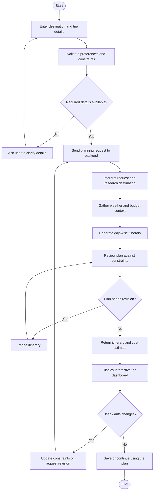
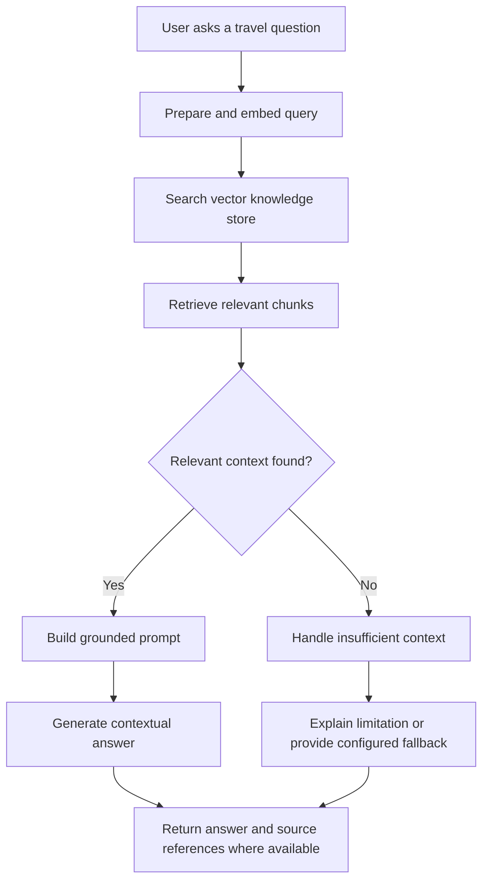
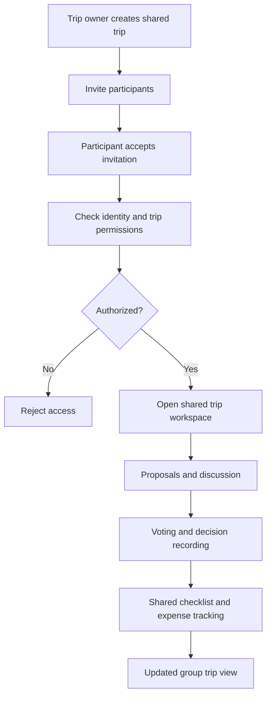
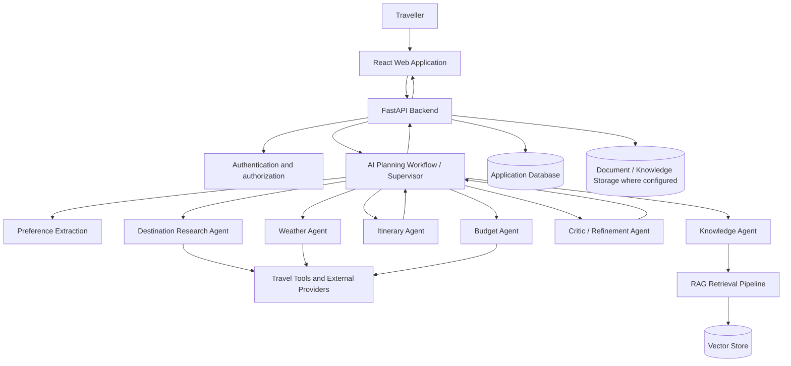
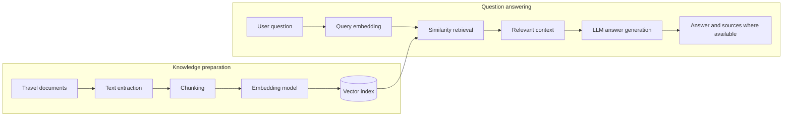
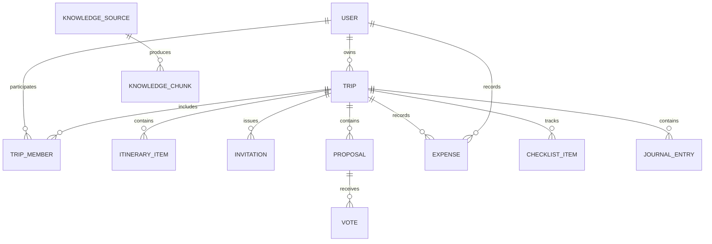
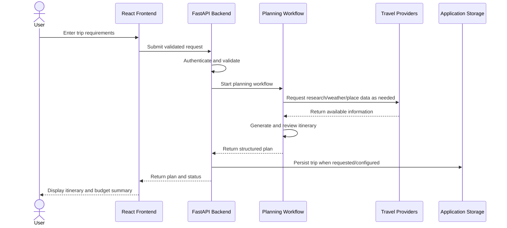

# Grevix AI Trip Weaver (PACK & GO) — AI-Powered Smart Travel Planning Platform

> **Grevix AfterCode | PACK & GO (Grevix AI Trip Weaver)**

Trip planning is fragmented across itinerary, budget, weather, map, research, and coordination tools. PACK & GO brings those steps into one AI-assisted workspace: travellers describe a destination, duration, budget, and interests, then review a personalized day-wise plan alongside available destination context, map links, cost estimates, packing help, trip utilities, saved trips, and contextual travel guidance.

The project was built for **Grevix AfterCode**. Its original hackathon vision and problem statement are preserved below; implementation status, provider dependencies, feedback, and known gaps are called out separately so the long-term vision is not mistaken for a verified live capability.

**Live demo:** [grevix-ai-trip-weaver.vercel.app](https://grevix-ai-trip-weaver.vercel.app/) · **Repository:** [patilshrutika1803/Grevix_AITripWeaver](https://github.com/patilshrutika1803/Grevix_AITripWeaver)

[](https://react.dev/)
[](https://vite.dev/)
[](https://fastapi.tiangolo.com/)
[](https://www.python.org/)
[](https://www.langchain.com/langgraph)
[](https://supabase.com/auth)

**Contents:** [Overview](#overview) · [Demo walkthrough](#demo-walkthrough) · [Feature status](#feature-status) · [Problem and vision](#1-hackathon-problem-statement-project-vision) · [Challenge Cards](#4-scope) · [Build / Decision Log](#build-and-decision-log) · [Architecture](#9-ai-planning-architecture) · [RAG](#10-retrieval-augmented-generation-rag) · [Feedback](#user-feedback-and-improvements) · [Setup](#local-setup-and-environment-configuration) · [Deployment](#deployment) · [Final checklist](#final-submission-checklist) · [Limitations](#known-limitations)

## Overview

PACK & GO coordinates personalized itinerary generation, budget awareness, available weather and destination information, map links, packing assistance, trip utilities, saved trips, and contextual guidance in one travel workspace. Specialized planning steps share the trip context rather than leaving travellers to stitch together separate tools. It is a planning assistant—not a booking service, a source of guaranteed live prices, or a fully offline travel application.

### Demo walkthrough

1. Open the [live website](https://grevix-ai-trip-weaver.vercel.app/).
2. Use **Log in** (`/login`) or create an account at `/register`. Supabase Auth, its callback URLs, the API, and MongoDB must be configured for account flows and protected data to work in the deployed environment.
3. Once signed in, open **Preferences** (`/preferences`) and save reusable travel style, interests, budget, accommodation, food, and destination preferences. Profile and preference routes require authentication.
4. Choose **Plan a trip** (`/plan`) and enter a destination, duration, budget, and interests. The planner route is public, but signing in allows the backend to use saved preferences and associate the generated trip with the account. AI responses depend on configured model credentials and provider availability.
5. Review the day-wise itinerary, estimated budget and category breakdown, place details, and OpenStreetMap search links. Weather context may be unavailable; the current plan summary can display “Good conditions” when no forecast was returned, so do not treat that label as a verified forecast.
6. Open **My trips** (`/trips`) and a saved trip to explore its **Utilities**, journal, expenses, and—when it is a group trip—collaboration workspace. Utilities include packing assistance, place/weather lookups, currency conversion, and schedule/route tools; live data and optimization depend on configured services and saved trip data.
7. On a saved trip, choose **Save for Offline**. Then open **Offline Vault** (`/offline-vault`) to find the local snapshot. Both trip pages and the Vault are protected routes; snapshots live in this browser’s IndexedDB and are not synced to another device.
8. Offline mode can reopen selected saved trip snapshots and, when previously cached, the app shell/static assets. It does **not** make backend APIs, authentication, AI, weather, place search, or other live services work offline, and offline edits are not synchronized.

### Feature status

“Implemented” below means the relevant path exists in the repository; it does not guarantee that a third-party provider is configured or reachable in every deployment.

| Feature | Current status | User benefit | Dependency or limitation |
|---|---|---|---|
| AI itinerary planning and revision | Implemented: streamed multi-agent planning, saved-trip day regeneration, and itinerary optimization tools | Produces a day-wise starting plan and supports changes | AI providers and research/weather integrations require configuration; results need traveller review |
| Saved preferences | Implemented: profile preferences are supplied to planning for signed-in users | Reduces repeated entry of travel style and interests | Supabase Auth, backend, and MongoDB must be available |
| Budget and expenses | Implemented: planning estimates/category breakdowns and saved-trip expense tools | Makes estimated trip costs and recorded spending visible | Estimates are not quotes; saved expense actions require access to the trip |
| Weather | Implemented with optional live-provider integration | Adds weather context and current-weather lookup | Provider/API key and network required; missing plan forecasts may be labelled “Good conditions” |
| Maps and route tools | Implemented: OpenStreetMap place searches, saved-trip map data, A* route, CSP schedule, and GA schedule preview | Helps inspect places and organize available trip stops | External place data and saved coordinates matter; route optimization needs at least two stops with coordinates |
| Packing assistance | Implemented for saved trips | Provides trip-specific preparation guidance | Requires an accessible saved trip; source data/provider availability can limit results |
| Explore | Implemented as a curated destination collection with links into planning | Offers a quick starting point for popular destinations | Not comprehensive or hidden-gem discovery; search/filter presentation is limited |
| Travel Guide / RAG | Implemented: indexed-source browsing and question answering | Answers destination questions against retrieved travel material | Requires available indexed sources, vector storage, embeddings, and model configuration |
| Saved trips | Implemented: list, open, update, and delete account trips | Keeps generated plans available for later review | Sign-in, API, and MongoDB required for account-backed persistence |
| Journal | Implemented: dated trip entries, media links, and trip statistics | Preserves trip notes and memories | Requires an authenticated user with access to the trip; media are HTTP(S) references, not uploaded files |
| Group workspace | Implemented: invitations, members/roles, proposals/votes, decisions, checklist, chat, notifications, and shared expenses | Keeps group planning and coordination with the trip | Requires an authenticated, authorized group-trip member; there is no public standalone chat |
| Authentication | Implemented with Supabase Auth and backend bearer-token validation | Protects profile, trip, and group data | Correct Supabase, callback, API-origin, CORS, and MongoDB configuration required |
| Offline Vault | Implemented as local IndexedDB trip snapshots plus a service-worker app shell/static cache | Reopens selected saved data on the same device | Not API caching, offline editing/sync, or full offline application functionality |

The project does not claim live location sharing, travel-safety monitoring, or hidden-gem discovery as implemented features.

---

## 1. Hackathon Problem Statement & Project Vision

Planning a trip often requires travellers to move between multiple disconnected tools to research destinations, compare attractions, estimate costs, check weather, arrange daily activities, prepare packing lists, and coordinate with other travellers. This process is time-consuming and can result in unrealistic schedules, overlooked constraints, inconsistent information, and budgets that are difficult to manage.

Generic itinerary generators may return a list of popular places without sufficiently considering a traveller’s interests, trip duration, spending limit, weather conditions, travel pace, or practical constraints. Recommendations may also lack supporting context, while changes to one part of a trip can require the user to manually revise the rest of the plan.

**Problem to solve:** How might we build an intelligent travel-planning platform that turns a traveller’s goals and constraints into a personalized, practical, budget-aware trip plan while bringing research, weather, maps, packing, expenses, and contextual assistance into one experience?

### 1.1 Target users

- **Solo travellers** who want a personalized itinerary without researching every detail manually.
- **Friends and families** who need a shared plan and a way to coordinate preferences and decisions.
- **Budget-conscious travellers** who need estimated costs and visibility into spending.
- **First-time visitors** who need destination research and contextual travel guidance.
- **Trip organizers** who need to keep schedules, packing, expenses, and logistics together.

### 1.2 Key challenges

| Challenge | Effect on travellers | Proposed response |
|---|---|---|
| Fragmented research | Information is scattered across multiple services | Centralize travel planning and supporting utilities in one dashboard |
| Generic itineraries | Plans may not reflect personal interests or constraints | Collect preferences and use a multi-step AI planning workflow |
| Unclear trip costs | Travellers may underestimate daily or total spending | Estimate costs and expose a budget breakdown |
| Weather uncertainty | Outdoor activities may be unsuitable for the conditions | Include weather information in planning and trip review |
| Inefficient schedules | Places may be arranged without considering time or travel order | Organize activities by day and support route/sequence optimization |
| Packing uncertainty | Important items can be forgotten | Generate a packing checklist based on trip context |
| Context gaps in AI answers | Generic answers may miss relevant travel information | Retrieve relevant knowledge before generating contextual responses |
| Group coordination overhead | Choices, tasks, and expenses can become difficult to track | Provide shared trip collaboration features |

### 1.3 Original Phase 1 workflow and 24-hour MVP

The Phase 1 vision was to coordinate several planning steps rather than return a single generic itinerary:

1. Understand the traveller's destination, dates or duration, interests, budget, and travel preferences.
2. Research relevant destinations and activities.
3. Consider budget and weather constraints while assembling a day-wise itinerary.
4. Review and refine the plan against the traveller's requirements.
5. Use RAG to provide contextual travel assistance from relevant knowledge.

Within the original 24-hour hackathon, the MVP objective was to demonstrate AI itinerary generation, personalized travel recommendations, budget and weather integration, and an interactive travel dashboard. These goals describe the registration idea; Section 4.4 records Challenge 2 work verified in this repository. The requirements and workflows in this SRS describe intended behavior and should not, by themselves, be read as proof that every feature or external integration is enabled.

## 2. Proposed Solution

PACK & GO provides a unified travel workspace. A user enters a destination, travel dates or duration, budget, interests, travel style, and other preferences. The planning workflow uses this context to research the destination, consider weather and budget constraints, generate a day-by-day itinerary, estimate expenses, and refine the result. The traveller can review the plan, request changes, save the trip, and use supporting travel tools from the same platform.

The proposed experience is organized around five principles:

1. **Personalization:** plans should reflect the traveller’s preferences and constraints.
2. **Practicality:** itinerary suggestions should consider duration, budget, weather, and activity order.
3. **Explainable planning flow:** specialized steps should make it easier to understand how a plan is assembled and refined.
4. **Contextual assistance:** answers should use relevant travel knowledge when available.
5. **One travel workspace:** itinerary, expenses, packing, utilities, and collaboration should be accessible together.

## 3. Objectives and Expected Outcomes

- Generate structured, day-wise travel itineraries from user inputs.
- Adapt recommendations to destination, duration, budget, interests, and travel preferences.
- Present an estimated trip cost and a useful budget breakdown.
- Surface relevant weather and destination information to support planning decisions.
- Allow users to review, revise, and save trip plans.
- Provide packing assistance and trip utilities in the planning workflow.
- Support contextual travel questions using a retrieval-based knowledge pipeline.
- Provide a shared workspace for group planning, coordination, and expense tracking.

## 4. Scope

### 4.1 Core scope for the original Phase 1 MVP

- Travel request and preference collection.
- AI-assisted itinerary generation.
- Personalized destination and activity recommendations.
- Budget estimation and cost breakdown.
- Weather information within the planning experience.
- Interactive dashboard to review the generated plan.
- Ability to revise the plan through additional user instructions.

### 4.2 Extended platform scope

- Account and preference management.
- Saved trip management.
- Place and destination research.
- Packing checklist and travel utilities.
- Currency conversion and expense tracking.
- Route or visit-order optimization.
- RAG-powered travel knowledge and contextual Q&A.
- Group trip invitations, members, proposals, voting, decisions, chat, and shared checklists.
- Trip journal and administrative knowledge-management functions.

### 4.3 Challenge Card 1 — Initial MVP

The repository does not contain the official Challenge Card 1 prompt, so this section records the initial project objective documented in the submission rather than presenting it as a verbatim card. The original 24-hour MVP scope was a personalized, day-wise travel planner combining destination research, budget and weather context, itinerary review, and a travel dashboard, with contextual RAG assistance in the broader workflow.

The initial submission commit [`8c76b21`](https://github.com/patilshrutika1803/Grevix_AITripWeaver/commit/8c76b21) contains the React frontend, FastAPI backend, LangGraph planning agents, and RAG modules. It is the earliest tracked state, so the repository cannot establish a before/after change from an earlier Card 1 build. At that baseline, the implementation separates preference extraction, research, weather, budget, itinerary generation, and critique rather than treating planning as one opaque generation step. The trade-off is that external data and model calls remain provider-dependent; estimates and generated recommendations are not guaranteed live facts. See [Problem Statement & Project Vision](#1-hackathon-problem-statement-project-vision), [AI Planning Architecture](#9-ai-planning-architecture), and [Feature Status](#feature-status) for the intended scope and current implementation boundaries.

### 4.4 Challenge Card 2: Completed Work

The official Challenge Card 2 prompt is not stored in the repository. The following account therefore describes the evidence-backed work recorded for this stage, not a quotation of the card objective. The repository history shows a shift toward making the existing travel workspace more resilient and deployment-ready: selected trip snapshots can be saved locally, authentication/API routing was hardened, and production response contracts were corrected. Feedback screenshots were reviewed separately below; the repository does not establish that each suggestion was implemented as a result of that feedback.

The following entries are ordered by the confirmed Git history. These Challenge 2 changes improve reliability and access to existing features; they do not imply that every external provider is configured.

| Date | Commit | Problem addressed | Verified change | User benefit |
|---|---|---|---|---|
| 2026-10-11 | [`3080831`](https://github.com/patilshrutika1803/Grevix_AITripWeaver/commit/3080831) | A saved itinerary had no device-local way to reopen selected trip details, and the web app had no installable/offline shell foundation. | Added IndexedDB-backed trip, weather, and place snapshots, a web manifest and service worker, and an authenticated Offline Vault; stabilized backend Supabase-token and MongoDB configuration. API requests are deliberately excluded from service-worker caching. | Signed-in travellers can keep selected trip data and previously cached app-shell assets on the same device, without confusing that for offline API access. |
| 2026-10-11 | [`5c75b15`](https://github.com/patilshrutika1803/Grevix_AITripWeaver/commit/5c75b15) | The project needed a clearer written record of the registered vision and Challenge 2 scope. | Updated the README’s hackathon vision and Phase 2 progress; this was documentation-only, not an application feature change. | Preserved the original goal and made project status easier to distinguish from future scope. |
| 2026-10-11 | [`6a11f89`](https://github.com/patilshrutika1803/Grevix_AITripWeaver/commit/6a11f89) | Offline snapshots could be incomplete or stale, and browser storage/refresh failures needed safer handling. | Added snapshot validation and recovery guidance, freshness indicators, associated-record cleanup, and explicit storage errors; added focused offline storage, snapshot, and Vault tests. Refresh failures do not silently replace an existing saved snapshot. | Makes local trip copies easier to evaluate and recover without losing a previously saved copy on refresh failure. |
| 2026-10-11 | [`2f9ef38`](https://github.com/patilshrutika1803/Grevix_AITripWeaver/commit/2f9ef38) | Production sign-in callbacks, post-login redirects, API origin selection, and direct frontend-route refreshes needed explicit handling. | Added the Supabase callback flow, safe local redirects, production API-origin handling, and Vercel SPA rewrites for client routes. | Supports sign-in/recovery and direct route loads while preserving protected-route checks and avoiding a silent fallback to a local backend. |
| 2026-10-11 | [`732e3b2`](https://github.com/patilshrutika1803/Grevix_AITripWeaver/commit/732e3b2) | Production clients needed consistent response metadata/group detection and safer journal validation/error responses. | Returned preference `updated_at`, added `is_group` (default `false`) to trip responses, validated journal media links, returned field-specific journal validation details, and aligned trip-page loading and API error handling with the contracts. | Prevents clients from losing metadata or requesting group-only data for personal trips, and gives clearer journal/API validation feedback. |

## 5. Stakeholders and User Roles

| Role | Needs and responsibilities |
|---|---|
| Visitor | Understand the platform and access public discovery or authentication entry points |
| Traveller | Enter trip requirements, generate plans, manage preferences, and review travel information |
| Trip owner/organizer | Create a shared trip, invite participants, and coordinate the group plan |
| Group member | Review shared trip details and participate in permitted collaboration activities |
| Administrator | Manage designated administrative functions and knowledge sources |
| External service/provider | Supply model responses or supporting data such as weather, places, maps, or currency rates |

## 6. Functional Requirements

### FR-01 — Travel request input

The system shall collect the information needed to begin planning, including destination, trip duration or dates, budget, interests, and relevant travel preferences. Where essential information is missing, the interface should allow the user to provide or clarify it.

**Expected result:** a structured travel request that can be passed to the planning workflow.

### FR-02 — Preference-aware planning

The system shall use the traveller’s stated interests, travel style, budget, duration, and other available preferences to guide destination recommendations and itinerary generation.

**Expected result:** suggestions are relevant to the submitted request rather than a generic list of attractions.

### FR-03 — AI itinerary generation

The system shall generate a day-wise itinerary with activities organized into a readable sequence. Each itinerary item should include useful details where available, such as place/activity name, description, suggested timing, and estimated cost.

**Expected result:** a structured plan that the traveller can review and refine.

### FR-04 — Destination research

The system shall support destination and place research to provide relevant information for itinerary choices. Search results and generated recommendations should be presented clearly, with external information identified where applicable.

### FR-05 — Budget estimation

The system shall estimate trip expenses from the available trip inputs and activity information. Where sufficient data exists, the system should summarize expected costs by category or day and compare the estimate with the user’s budget.

**Expected result:** a visible cost estimate that helps the traveller judge whether the plan is financially practical.

### FR-06 — Weather-aware planning

The system shall retrieve or present relevant weather information when the configured provider is available. Weather information should help users evaluate outdoor activities and decide whether an itinerary needs adjustment.

### FR-07 — Itinerary revision

The system shall allow the traveller to request changes, such as changing the budget, duration, interests, or activities. The planning workflow should use the revised constraints to regenerate or update the plan where supported.

### FR-08 — Plan review and persistence

The platform shall provide an interactive view of the itinerary and support saving and retrieving trip information for authenticated users where configured.

### FR-09 — Packing assistance

The platform shall support a packing checklist informed by trip context, such as destination, duration, weather, and planned activities. Users should be able to review items and track their packing progress where the checklist interface is available.

### FR-10 — Map, place, and route utilities

The platform shall expose place-related information and map or route assistance where a suitable provider or integration is configured. The user should be able to inspect trip locations and use route or visit-order tools where supported.

### FR-11 — Contextual travel Q&A with RAG

The system shall support a retrieval-based question-answering workflow. Relevant travel documents or knowledge content are processed, indexed, retrieved for a user question, and supplied as context to the answer-generation step.

**Expected result:** responses informed by retrieved material when relevant content is available, rather than relying only on an unconstrained model response.

### FR-12 — Travel utilities

The platform shall make relevant trip utilities available from the travel workspace. These may include currency conversion, weather lookup, place search, route assistance, and expense calculations according to configured integrations.

### FR-13 — Expense management

The platform shall support recording trip expenses and presenting summaries. For group trips, expense visibility and permitted actions should follow the trip’s access rules.

### FR-14 — Group planning and coordination

The extended platform shall support shared trip workspaces with member management and invitations. Where enabled, members can discuss options, submit proposals, vote, record decisions, use shared checklists, and view notifications.

### FR-15 — Trip journal

The platform shall provide a place to record trip notes or memories and associate them with a trip where the journal feature is enabled.

### FR-16 — Authentication and access control

Private trip and profile operations shall require authentication. Server-side authorization shall determine whether a user may access or modify a resource; hiding a control in the frontend alone shall not be treated as authorization.

### FR-17 — Administrative functions

Designated administrative interfaces shall be restricted to authorized administrators. Administrative actions should be validated and logged where supported.

## 7. Non-Functional Requirements

| ID | Requirement | Description |
|---|---|---|
| NFR-01 | Usability | The user should be able to enter trip requirements and understand the resulting itinerary without needing technical knowledge. |
| NFR-02 | Responsiveness | The interface should present progress and results clearly during longer planning operations where streaming is supported. |
| NFR-03 | Modularity | Frontend, API, AI agents, tools, services, and data access should remain logically separated. |
| NFR-04 | Security | Secrets must be kept out of source control; protected resources require authentication and authorization. |
| NFR-05 | Reliability | External-provider failures and invalid inputs should be handled with useful errors where implemented. |
| NFR-06 | Maintainability | Features should be organized into reusable components and services. |
| NFR-07 | Extensibility | New agents, travel utilities, and data providers should be addable without redesigning the whole application. |
| NFR-08 | Data integrity | User and trip records should preserve ownership and consistency through validated operations and database constraints where configured. |
| NFR-09 | Privacy | User-specific trip details and group data should only be accessible to authorized users. |
| NFR-10 | Transparency | Estimated prices, weather, and generated recommendations should be treated as planning assistance and may require user verification. |

## 8. User Journeys and End-to-End Workflows

### 8.1 Primary journey: plan a trip

1. The user opens PACK & GO.
2. The user enters a destination, duration or dates, budget, interests, and travel preferences.
3. The application validates the request and passes it to the backend planning endpoint.
4. The AI workflow interprets the request and gathers relevant destination information.
5. Weather and budget-related information are considered when the required integrations are available.
6. The itinerary agent assembles a day-wise plan.
7. A review/critic step evaluates the plan against the supplied constraints and requests refinement when supported.
8. The backend returns the structured plan and relevant cost information.
9. The frontend presents the plan in an interactive dashboard.
10. The user reviews the result, requests changes, and saves the trip where persistence is enabled.



### 8.2 Change a trip constraint

When the traveller changes an important constraint—such as budget, trip length, or interests—the application should pass the updated information into the revision workflow. The plan should be updated or regenerated according to the available functionality. The revised result should be shown to the user for review rather than silently replacing their intent.

### 8.3 Ask a contextual travel question

1. The user submits a question in the knowledge or travel-assistance interface.
2. The backend prepares the query for retrieval.
3. The RAG pipeline searches the configured knowledge index for relevant content.
4. Retrieved context is provided to the language model.
5. The answer is returned to the interface, with source context or citations where supported.



### 8.4 Group trip coordination

1. An authorized trip owner creates or opens a shared trip.
2. The owner invites participants using the configured invitation mechanism.
3. Participants accept the invitation and access the trip according to their permissions.
4. Members review the shared itinerary and contribute proposals or comments where enabled.
5. Members vote on proposed options and record decisions where the collaboration workflow supports it.
6. The group uses shared checklists, chat, notifications, and expense tracking as available.



## 9. AI Planning Architecture

PACK & GO uses a coordinated workflow rather than treating travel planning as a single prompt. Specialized agents and tools divide the work into smaller responsibilities. The supervisor/workflow coordinates these steps and combines their results into the final response.

### 9.1 Agent responsibilities

| Agent or component | Responsibility |
|---|---|
| Supervisor / workflow | Interpret the request, coordinate the planning stages, and manage control flow |
| Research agent | Gather destination and activity context using configured search or place tools |
| Preference extractor | Identify relevant user constraints and preferences from the request |
| Itinerary agent | Produce a structured day-wise plan |
| Budget agent | Estimate or organize trip costs against the user’s spending limit |
| Weather agent | Retrieve and interpret available weather information for trip planning |
| Critic / review agent | Review the proposed plan against requirements and identify issues for refinement |
| Knowledge agent | Support travel questions using retrieved knowledge context |
| Tool layer | Provide operations such as place lookup, weather retrieval, currency conversion, and expense calculation |

### 9.2 High-level architecture



### 9.3 Planning workflow

The planning workflow should preserve the user's original constraints as it gathers information and builds the itinerary. Research, weather, cost estimation, itinerary construction, and critique are separate responsibilities so that the workflow can be adjusted or extended. The final plan is returned in a structured form suitable for the frontend to display by day and activity.

### 9.4 Constraint-aware itinerary generation

The platform includes itinerary optimization approaches intended to help organize activities under constraints:

- **Constraint Satisfaction Problem (CSP):** represents planning requirements as constraints and searches for an assignment that satisfies them.
- **Genetic Algorithm (GA):** explores candidate itinerary arrangements and evolves candidates using a fitness measure.
- **Route optimization:** supports improving the order of visits based on the information and constraints available to the route service.

These techniques complement AI-generated suggestions. Their usefulness depends on the completeness and quality of the supplied locations, durations, costs, and constraints.

## 10. Retrieval-Augmented Generation (RAG)

RAG provides a way to answer questions using relevant information from a configured travel knowledge collection. It separates knowledge preparation from question answering.

### 10.1 Knowledge ingestion

1. Receive or select a supported knowledge source.
2. Extract readable text from the source.
3. Split the text into manageable chunks while preserving useful context.
4. Generate embeddings for the chunks.
5. Store vectors and associated metadata in the configured vector store.

### 10.2 Query-time retrieval

1. Receive a user's question.
2. Convert the question into a retrieval representation.
3. Search the vector store for relevant chunks.
4. Assemble retrieved material into the model context.
5. Generate a response based on the question and retrieved material.
6. Return the answer and source information when available.



RAG quality depends on source quality, chunking, retrieval relevance, prompt design, and model behaviour. If relevant context is not available, the system should avoid implying that an answer is supported by a source that was not retrieved.

## 11. Website Information Architecture and Feature Details

The following sections describe the intended responsibilities of the main user-facing areas. Availability of individual functions depends on the configured application environment and integrations.

### 11.1 Landing page

Introduces PACK & GO, explains its travel-planning value, and directs users to discovery or planning entry points.

### 11.2 Authentication

Provides sign-in and account-related flows. Authentication configuration, callback URLs, and server-side token validation are required for protected actions.

### 11.3 Profile and preferences

Allows a traveller to manage profile information and reusable travel preferences. Preference data can be supplied to the planning workflow to reduce repeated input.

### 11.4 AI planner

Collects trip requirements and displays generated plans. The planner is the main entry point for submitting a request, reviewing the itinerary, inspecting cost information, and requesting revisions.

### 11.5 Trips and trip details

Organizes saved trips and presents the itinerary for a selected trip. Trip details can act as the central place for itinerary review and access to related trip tools.

### 11.6 Explore and travel guide

Supports destination discovery and place research. Available results depend on the connected data providers and their coverage.

### 11.7 Group workspace

Organizes participants and shared trip activity. Depending on enabled functionality, this area includes member management, invitations, proposals, voting, decisions, chat, checklists, and notifications.

### 11.8 Expense manager

Records travel expenses and presents summaries to help users understand spending. Currency and totals should be interpreted according to the currency and exchange-rate information available to the application.

### 11.9 Trip journal

Provides a space to preserve trip notes and memories associated with a trip.

### 11.10 Travel utilities

Groups supporting tools such as weather lookup, currency conversion, place information, route assistance, and packing or expense calculations where configured.

### 11.11 Knowledge center

Provides the user interface for travel knowledge sources and contextual question answering. Knowledge ingestion and retrieval depend on backend configuration and supported source formats.

### 11.12 Administration

Provides designated administrative views and knowledge-management actions for authorized users only.

## 12. Group Travel Requirements

Group travel introduces shared state and permission requirements in addition to ordinary trip planning.

### 12.1 Membership and invitations

- A trip owner can invite participants through the configured invitation flow.
- Invitation acceptance must be validated by the backend.
- Membership changes must respect the trip's access policy.
- Shared resources must be scoped to the correct trip and authorized participants.

### 12.2 Proposals, votes, and decisions

- Members can submit proposals where permitted.
- Voting actions must be associated with the correct proposal and authorized member.
- The application should record the resulting decision or decision state.
- The interface should clearly communicate proposal status and recorded outcomes.

### 12.3 Shared communication and checklist

- Members can access trip-related discussion where enabled.
- Shared checklist items help coordinate preparation and tasks.
- Notifications should communicate relevant collaboration events where configured.

### 12.4 Shared expenses

- Expense records should be associated with the correct trip.
- Access and modification should follow membership permissions.
- Summaries should make recorded costs understandable to the group.

## 13. Data Requirements and Conceptual Model

The application needs to associate user-owned information with the correct user and trip. The conceptual entities below describe the information domain rather than prescribing a single physical database implementation.

| Entity | Purpose | Typical relationships |
|---|---|---|
| User | Identity, profile, and preferences | Owns trips and personal settings |
| Trip | Destination, dates/duration, budget, and trip state | Belongs to an owner; may have members, itinerary items, expenses, and journal entries |
| Itinerary item | Activity, place, day, timing, and estimated cost | Belongs to a trip or itinerary |
| Trip member | Membership and role within a shared trip | Connects a user to a trip |
| Invitation | Invitation state and acceptance information | Connects an invitee to a trip |
| Proposal | Suggested activity or group option | Belongs to a trip and may have votes |
| Vote / decision | Group choice and its recorded outcome | Relates to a proposal and trip participants |
| Expense | Cost, category, date, and associated trip | Belongs to a trip and a recording user |
| Checklist item | Preparation or coordination task | Belongs to a trip and may have completion state |
| Journal entry | Trip note or memory | Belongs to a user and/or trip |
| Knowledge source | Document or information source used by RAG | Produces chunks indexed in the vector store |
| Knowledge chunk | Text segment and metadata used for retrieval | Belongs to a source and has an embedding/index entry |

### Conceptual entity relationship diagram



## 14. API and Integration Design

The frontend communicates with the backend through HTTP APIs. The API layer validates requests, applies authentication and authorization where required, invokes business services or AI workflows, and returns structured responses.

### 14.1 API responsibility groups

| API group | Responsibility |
|---|---|
| Trips | Create, retrieve, update, and manage trip records and planning requests |
| Users | Profile and preference operations |
| Collaboration | Group membership, invitations, proposals, votes, decisions, and shared trip activity |
| Expenses | Record and summarize trip expenses |
| Journal | Manage trip journal entries |
| Knowledge | Manage supported knowledge sources and ask contextual questions |
| Utilities | Expose travel-related utility operations such as weather, currency, or place lookup |
| Admin | Provide authorized administrative operations |

### 14.2 External integrations

The platform is designed to use configured external providers for language-model inference, embeddings, weather, place research, maps or routes, currency conversion, and authentication. The exact data available to the application depends on the selected provider, API credentials, usage limits, and network availability.

### 14.3 Integration flow



## 15. Technology Architecture

The project is organized as a web application with a separate frontend and Python backend.

### 15.1 Source structure

| Area | Repository path | Responsibility |
|---|---|---|
| Frontend | `frontend/src/` | React pages, reusable components, API client, authentication, and offline trip storage |
| Frontend shell/assets | `frontend/public/`, `frontend/index.html`, `frontend/vite.config.js` | PWA manifest, service worker, static assets, and local development proxy |
| HTTP API | `api/v1/` | FastAPI route groups for trips, users, collaboration, expenses, journal, knowledge, utilities, and administration |
| AI workflow | `agent/` | Planning supervisor and specialized preference, research, weather, budget, itinerary, critic, and knowledge agents |
| Services and tools | `services/`, `tools/` | Trip and collaboration behavior, itinerary/route algorithms, expenses, and external travel utilities |
| RAG | `rag/` | Knowledge ingestion, chunking, embeddings, retrieval, and response generation |
| Data and migrations | `database/`, `models/`, `alembic/` | Database access, data models, and relational migration support |
| Documentation and feedback | `docs/`, `FEEDBACK/` | Deployment guidance and the supplied feedback screenshots |
| Tests and project config | `tests/`, `frontend/tests/`, `.env.example`, `requirements.txt`, `pyproject.toml` | Backend Python tests, frontend Node.js tests, placeholder configuration, and Python dependencies |

### 15.2 Technology stack

| Layer | Technology / component | Responsibility |
|---|---|---|
| Frontend | React 19, React Router, Vite 8, JavaScript, and CSS | Interactive pages, itinerary display, forms, and trip workspace |
| API backend | Python 3.12+, FastAPI, and Pydantic | HTTP endpoints, request validation, authorization, and service orchestration |
| AI orchestration | LangGraph workflow and specialized agents | Coordinate research, itinerary, budget, weather, review, and knowledge tasks |
| Language-model and travel integrations | Configured Groq/Gemini and travel-data providers | Generate planning responses and supply available place, weather, and currency data |
| RAG and vector storage | Chunking, sentence-transformer embeddings, retrieval, generation, and ChromaDB | Retrieve relevant travel knowledge for question answering |
| Application data and authentication | MongoDB and Supabase Auth | MongoDB stores application records; Supabase Auth manages browser sessions and supports backend bearer-token verification |
| Relational data tooling | SQLAlchemy and Alembic | Relational models and migration tooling are present in the repository; the current application data layer uses MongoDB |
| Maps and routes | OpenStreetMap search links and route-optimization utilities | Open place searches and organize itinerary locations where supported |
| Testing | Pytest, Node.js built-in test runner, and Oxlint | Exercise backend and frontend behavior and lint frontend code |

### 15.3 Environment and development configuration

The root `.env.example` is a placeholder reference for configuration; supply local values in an untracked environment file and do not put credentials in source control. Backend configuration includes `SUPABASE_URL`, `SUPABASE_ANON_KEY`, `MONGODB_URI`, `MONGODB_DATABASE`, and `PACK_GO_ALLOWED_ORIGINS`. Frontend configuration uses `VITE_SUPABASE_URL`, `VITE_SUPABASE_ANON_KEY`, and `VITE_API_BASE_URL`. Optional provider and local RAG/storage settings are also represented in the template.

The Vite development configuration reads the repository-root environment and proxies the health, planning, and `/api/v1` requests to the local FastAPI service. Frontend test/build/lint scripts are declared in `frontend/package.json`. Backend tests use Pytest from the repository root; Pytest is not a runtime dependency in `requirements.txt`, so install it separately in a development environment if needed.

### 15.4 Development tools and AI coding assistants

The tracked project configuration and scripts establish Git for version history, npm/Node.js for frontend development and tests, and Python/Pytest for backend development and tests. These are development tools, separate from the services and libraries integrated into the application above. The repository does not identify which AI coding assistant(s), if any, were used during the original project development; that detail is left unclaimed pending confirmation.

## 16. Security, Privacy, and Error Handling

- Authentication must be validated before protected operations are performed.
- Server-side authorization must enforce trip ownership, group membership, and administrative roles.
- API keys, database credentials, and private tokens must be supplied through environment configuration and must not be committed to the repository.
- User input should be validated before it reaches AI workflows, database operations, or external providers.
- Errors from model providers and travel APIs should be handled without exposing credentials or internal stack traces to end users.
- Personal and group trip information should not be exposed across unrelated users or trips.
- External data such as weather, route information, and estimated prices may change and should be rechecked when necessary.
- AI-generated itineraries and estimates are decision-support suggestions; travellers should verify time-sensitive information before relying on it.

## 17. Constraints and Assumptions

- The quality of recommendations depends on the completeness of the user’s input and the available destination information.
- Weather, map, place, currency, and model features depend on configured external services and their availability.
- Budget values are estimates unless based on verified live prices.
- Route optimization depends on the locations, travel durations, and constraints available to the system.
- RAG answers depend on the quality, coverage, and relevance of the indexed knowledge sources.
- Group functionality requires reliable identity, membership, and permission checks.
- Long-running AI operations may take time and should communicate progress where streaming is supported.

## 18. Acceptance Criteria

The initial MVP is considered demonstrable when the following core journey can be completed in the configured environment:

1. A traveller can provide a destination, duration, budget, and interests.
2. The application accepts the request and returns a structured itinerary.
3. The itinerary is organized into understandable days and activities.
4. The response includes cost information when sufficient data is available.
5. Weather or destination context is incorporated when the required integration is available.
6. The user can review the result and request a revision.
7. The interface presents the generated plan in a coherent travel dashboard.

The broader platform requirements can be evaluated separately for saved trips, RAG question answering, packing assistance, utilities, expense management, and group collaboration according to the corresponding integrations and flows enabled in the environment.

## 19. Expected Impact

PACK & GO aims to reduce the friction of travel planning by bringing personalized itinerary generation and practical trip organization into one experience. By combining AI planning with budget awareness, weather and destination context, supporting utilities, and collaboration, the platform helps travellers move from a broad idea to a plan they can review, adjust, and use.

The key value is not simply generating a list of places. It is coordinating the information and constraints that make a trip more realistic: **where to go, what to do, when to do it, how much it may cost, what to prepare, and how to adapt the plan when requirements change.**

## Judge Snapshot

- **Problem:** Trip planning means reconciling places, schedules, costs, conditions, and group preferences across disconnected sources. PACK & GO is designed to bring that work into one reviewable trip workspace.
- **Beyond a basic itinerary generator:** a LangGraph workflow coordinates preference extraction, destination research, weather and budget steps, itinerary generation, and critique; the saved trip then connects to maps, utilities, expenses, a journal, and group tools.
- **Less repeated input:** signed-in travellers can save profile preferences and supply them to later planning requests. Users can still provide trip-specific constraints for each plan.
- **Challenge 2 reliability work:** the verified commits introduced device-local trip snapshots and app-shell caching, recovery/freshness/error handling, production auth callbacks and SPA route delivery, plus API contract and journal-validation fixes.
- **Vision versus implementation:** the Phase 1 registration goals and SRS below preserve the project’s intended scope. The Feature status table describes the current code; third-party data, production configuration, and full offline capability are explicitly conditional or out of scope.
- **Realistic next steps:** make homepage feature cards navigable, distinguish missing weather data from a forecast, verify the mobile feedback at device widths, consider hidden-gem and safety information, and resolve the failing frontend and backend test suites. These are not claimed as completed work.

## Phase 3 — Final Polish, Feedback Review, and Validation

Phase 3 work recorded here is documentation and evidence review. This README update does not change application code, configuration, dependencies, deployment settings, or database schemas. Historical implementation work is listed under Challenge 2 above and linked to confirmed commits.

| Phase 3 item | Verified state | User/judge impact |
|---|---|---|
| Final-submission README audit (this documentation update) | Adds the backend deployment and point-in-time health results, reconstructs the build/decision timeline from Git, distinguishes repository evidence from unavailable card/tool details, and adds a deliverables checklist and feedback-folder link with a privacy caution. Existing feature, setup, test, and deployment notes are retained. | Makes it easier to assess what is implemented, what was verified, what remains dependent on configuration, and what needs team confirmation. |
| Existing UI behavior checked; not attributed to new work | Explore destination cards link into planning, but landing-page feature cards are static articles. The place-detail close control is in the modal header below its photo, not over the photo. Responsive CSS and hover/focus styles exist, but the requested mobile and interactive-affordance changes have not been verified as complete. | Records specific usability gaps rather than presenting suggestions as fixed. |
| Missing-weather state checked; not fixed | `PlanCard` currently falls back to “Good conditions” when `weather.conditions` is absent. No weather-label change is claimed. | Avoids confusing missing forecast data with a positive forecast; correcting the label remains a follow-up. |

### Validation results

| Command and working directory | Result |
|---|---|
| `npm run lint` (`frontend/`) | Passed. |
| `npm run build` (`frontend/`) | Passed. Vite emitted a chunk-size advisory: the minified JavaScript bundle is 683.67 kB, above the 500 kB advisory threshold. |
| `npm test` (`frontend/`) | 34 tests total: 32 passed and 2 failed in `tests/offline-vault-page.test.js`. Both failures stem from an assertion expecting `/Updated /` while the UI renders “Last updated …”; the frontend suite is not fully green. |
| `python -m pytest -q` (repository root, project virtual environment) | 143 passed, 45 failed, 73 errors, and 2 warnings. The backend suite is not green; failures and setup/runtime errors require separate triage. |

The live service check and its scope are recorded under [Deployment](#deployment). This verifies reachability/readiness, not a complete user journey. Account creation, Supabase email callbacks, live itinerary generation, external-provider responses, trip persistence through the UI, and RAG behavior were not verified end to end against production credentials.

## Build and Decision Log

This concise timeline is reconstructed from the Git commit order and repository documentation. All listed commits are dated 2026-10-11; Git establishes their order, not exact work times, milestone hours, or the elapsed 24-hour schedule.

| Sequence | Evidence | Build milestone and decision |
|---|---|---|
| Initial submission | [`8c76b21`](https://github.com/patilshrutika1803/Grevix_AITripWeaver/commit/8c76b21) | Established the project baseline: a React/FastAPI application with LangGraph planning agents and RAG modules. The original MVP scope focuses on itinerary planning with preferences, budget/weather context, and destination research. |
| Requirements and architecture documentation | [`37d6f9a`](https://github.com/patilshrutika1803/Grevix_AITripWeaver/commit/37d6f9a), [`e585326`](https://github.com/patilshrutika1803/Grevix_AITripWeaver/commit/e585326) | Added and refined the problem statement, SRS, and architecture diagrams. The documents preserve the wider product vision, while the feature-status table distinguishes that vision from implemented and provider-dependent behavior. |
| Challenge 2 resilience and production hardening | [Challenge 2 commits](#44-challenge-card-2-completed-work) | Added the local Offline Vault and then improved snapshot recovery, freshness/error handling, production auth callbacks, SPA routing, and API response contracts. The design deliberately caches selected snapshots/app-shell assets rather than authenticated API traffic; offline changes are not synchronized. |
| Final evidence and documentation review | [`3f248f2`](https://github.com/patilshrutika1803/Grevix_AITripWeaver/commit/3f248f2) | Recorded feature limitations, test results, and feedback evidence. The current README adds a concise submission checklist and identifies details that cannot be established from repository evidence. |

**Constraints and lessons recorded in the project:** provider keys, network availability, and persistent storage affect integrations; generated costs and plans need traveller verification; a local trip snapshot is not offline API access; and feedback suggestions should remain labelled as open unless an implementation is evidenced. The official wording of both Challenge Cards, exact decision rationale beyond the commit/documentation record, and development-time AI assistant(s) are not in tracked files and should be supplied by the team if needed for the submission.

## User Feedback and Improvements

The [FEEDBACK folder in the public GitHub repository](https://github.com/patilshrutika1803/Grevix_AITripWeaver/tree/main/FEEDBACK) contains 17 screenshots of feedback conversations. They were reviewed and grouped into positive product themes, usability suggestions, and future requests; each suggestion was checked against current source and the confirmed Challenge 2 history before assigning a status. The repository does not record who collected the feedback, when it was collected, how many people participated, or whether every comment came from a hands-on product trial, so no such claims are made. The screenshots are qualitative evidence only: this summary does not infer user identities, quotes, counts, representativeness, or that every person tried every feature. No application-code change in the repository can be attributed specifically to these comments; features described as “already existed” predate this review, and the suggestions marked planned or pending remain open.

The screenshots may include personal identifiers and private conversation content. Confirm consent or redact the images before public submission if needed; this README summarizes themes without reproducing chat text or identifying people.

**Status labels:** **Implemented and verified** means the corresponding behavior is present in source and has a relevant passing test or code-path verification; **Already existed and was retained** means the feedback describes an existing feature rather than new work; **In progress / pending verification** means there is related functionality but the requested outcome is not confirmed; **Planned for a future version** means the suggestion is not implemented.

### What users liked

| Feedback theme | Status | Evidence-based note |
|---|---|---|
| Preference-based planning and generated day-wise itineraries | Already existed and was retained | Preference forms, streamed planning, and day regeneration exist in the app; screenshots mention saved preferences and generated plans. |
| Maps, destination details, timings, and budget breakdowns | Already existed and was retained | Itinerary place details, map search links, and estimated category costs are present; screenshots call out location and cost detail. |
| Visual design and a unified trip workspace | Already existed and was retained | The product combines planning, itinerary, saved-trip, and utility views; screenshots praise the presentation and having travel tools together. |
| Saved trips, Offline Vault, and the trip journal | Already existed and was retained | These features are present in the code; screenshots mention revisiting saved plans, the Vault, and recording trip memories. |

### Usability improvements

| Suggestion | Status | Current evidence / next step |
|---|---|---|
| Make homepage feature cards open their related pages | Planned for a future version | `LandingPage.jsx` renders the feature cards as `<article>` elements; they are not navigation links. |
| Improve small-screen alignment | In progress / pending verification | Responsive rules exist, but the specific feedback has not been checked against a handset-sized end-to-end view. |
| Make interactive controls easier to recognize | In progress / pending verification | Hover/focus styles exist in parts of the UI; comprehensive keyboard, pointer, and mobile verification is still needed. |
| Place the popup close button over the background photo | Planned for a future version | The place-detail close button is in the header beneath the photo, not positioned over it. |
| Say when weather data is unavailable | Planned for a future version | The generated-plan card currently uses the “Good conditions” fallback when no forecast condition exists. |

### Future feature requests

| Request | Status | Boundary |
|---|---|---|
| Discover hidden gems and lesser-known local places | Planned for a future version | Explore currently shows a small curated destination set; hidden-gem discovery is not implemented. |
| Add travel-safety information, emergency contacts, or location sharing | Planned for a future version | These safety features are not present. Any future location-sharing design would need explicit consent and privacy controls. |
| Plan together through group collaboration/chat | Already existed and was retained | Authorized group trips already include invitations, roles, proposals/voting, decisions, checklists, chat, notifications, and expenses. The screenshots’ suggestion is not treated as a new feature request still awaiting implementation. |

## Local Setup and Environment Configuration

Use Python 3.12 or later and Node.js/npm. From the repository root, create a local `.env` using the placeholder names in `.env.example`; never commit credentials. The frontend Vite configuration reads the repository-root environment file.

Backend, in the repository root:

```powershell
python -m pip install -r requirements.txt
python -m uvicorn main:app --host 127.0.0.1 --port 8001
```

Frontend, in `frontend/`:

```powershell
npm ci
npm run dev
```

The development server uses port 5173 and proxies `/health`, `/plan`, and `/api/v1` to the backend on port 8001. Relevant configuration keys are `SUPABASE_URL`, `SUPABASE_ANON_KEY`, `MONGODB_URI`, `MONGODB_DATABASE`, and `PACK_GO_ALLOWED_ORIGINS` on the backend; `VITE_SUPABASE_URL`, `VITE_SUPABASE_ANON_KEY`, and `VITE_API_BASE_URL` on the frontend. Provider keys (`GROQ_API_KEY`, `GOOGLE_API_KEY`, `TAVILY_API_KEY`, `OPENWEATHERMAP_API_KEY`, `EXCHANGE_RATE_API_KEY`, and `ALPHAVANTAGE_API_KEY`) and storage paths (`CHROMA_PERSIST_DIRECTORY`, `RAG_STORAGE_DIRECTORY`) are optional for their corresponding integrations. `.env.example` is the source of truth for the complete key list and contains placeholders only.

Useful project commands:

```powershell
# From frontend/
npm run dev
npm run build
npm run preview
npm run lint
npm test

# From the repository root
# Install Pytest separately if it is not already available in the development environment:
# python -m pip install pytest
python -m pytest
```

## Deployment

- **Live frontend:** [https://grevix-ai-trip-weaver.vercel.app/](https://grevix-ai-trip-weaver.vercel.app/)
- **Backend service:** [https://grevix-aitripweaver.onrender.com](https://grevix-aitripweaver.onrender.com) · [health](https://grevix-aitripweaver.onrender.com/health) · [readiness](https://grevix-aitripweaver.onrender.com/health/ready)
- **Public source repository:** [patilshrutika1803/Grevix_AITripWeaver](https://github.com/patilshrutika1803/Grevix_AITripWeaver)

**Deployment architecture:** Vercel serves the Vite/React single-page frontend. The browser calls the separate FastAPI service on Render using `VITE_API_BASE_URL`; Supabase Auth supplies browser sessions and bearer tokens, and MongoDB stores application data. ChromaDB and uploaded RAG files use configured local/persistent storage rather than MongoDB; persistent production vector/file storage is conditional on a Render disk and was not verified. The API and provider-backed features require their corresponding server environment variables and external services.

On 2026-10-11, the frontend returned its application page, backend `/health` returned `{"status":"ok"}`, and `/health/ready` returned `{"status":"ready","database":"connected"}`. This is a point-in-time reachability/readiness check, not proof of end-to-end authentication, AI generation, provider calls, RAG, or every frontend feature. No deployment was performed for this README change.

The documented Vercel configuration uses `frontend/` as the project root, `npm run build` as the build command, and `dist/` as the output directory; `frontend/vercel.json` rewrites client-side routes to the SPA entry point. The documented Render target uses the repository root, Python 3.12, `pip install -r requirements.txt`, and `uvicorn main:app --host 0.0.0.0 --port $PORT`; `/health/ready` is its readiness endpoint. Refer to [PRODUCTION_ENVIRONMENT.md](docs/PRODUCTION_ENVIRONMENT.md) for detailed settings and required callback/origin configuration.

The placeholder environment variable names and local run commands are documented in [Local Setup and Environment Configuration](#local-setup-and-environment-configuration) and `.env.example`. Do not put secrets in the README or frontend configuration; Vite `VITE_` values are public in the built browser assets.

## Final Submission Checklist

- [x] Project name and concise description.
- [x] Problem, intended users, solution, value proposition, and end-to-end journey.
- [x] Live frontend and backend URLs, with the exact scope of the health/readiness verification stated.
- [x] Public GitHub repository and local setup/environment-variable instructions using placeholders.
- [x] Application technologies, AI workflow/agents, external dependencies, and deployment architecture documented from project files.
- [x] Feedback themes, the 17-image evidence folder, implemented-versus-open status, and a privacy caution documented.
- [x] Build / Decision Log added from repository history and existing project documentation.
- [x] Evidence links provided for the initial submission, Challenge 2 commits, feedback folder, and live service checks.
- [ ] Challenge Card evolution: repository-based account is included, but the official wording/objectives for both cards need team confirmation.
- [ ] Development AI coding assistant(s): not identifiable from tracked project files; add the actual tool names if used.
- [ ] Public feedback evidence: confirm consent or redact personal identifiers/private conversation content in `FEEDBACK/` before submission.

## Known Limitations

- Offline support is limited to the app shell/static assets and selected trip snapshots saved on the same browser/device. It does not cache backend APIs, synchronize offline edits, or make the whole application available offline.
- Weather, AI generation, place lookup, currency conversion, and persistent RAG content depend on provider credentials, network access, provider limits, and (for persistent local vector/file data in deployment) configured persistent storage.
- Weather data is optional. When the generated plan has no `weather.conditions`, its summary currently falls back to “Good conditions”; users should not interpret that label as a verified forecast.
- Explore currently shows a curated destination collection rather than a comprehensive or specifically hidden-gem discovery service.
- The landing-page feature cards, Explore search/filter controls, and some place-modal action buttons are presentational rather than fully wired navigation/actions.
- Homepage feature cards are informational `<article>` elements rather than links, even though feedback indicates that users may expect them to open the corresponding features.
- Group chat and collaboration require an authenticated, accessible group trip. Live location sharing and emergency-contact management are not implemented.
- Itinerary recommendations and budgets are AI-generated estimates; check current schedules, opening hours, prices, weather, and travel details with authoritative sources before departure.
