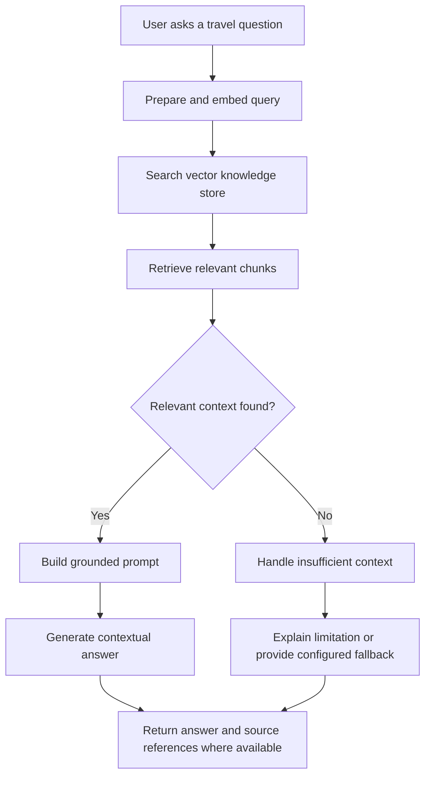
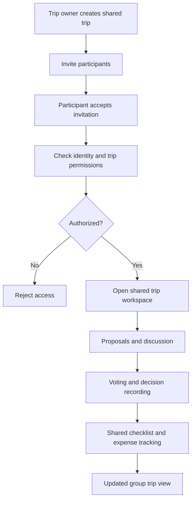
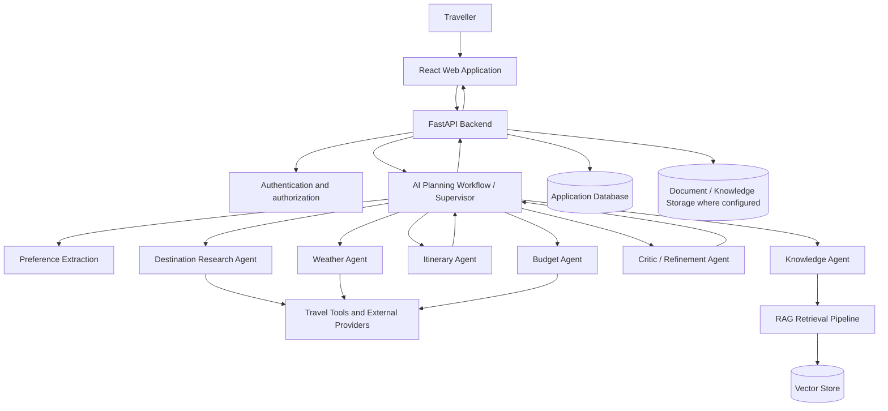
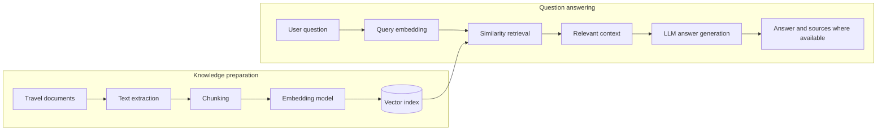
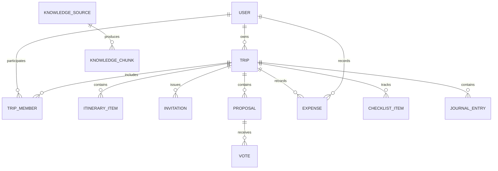
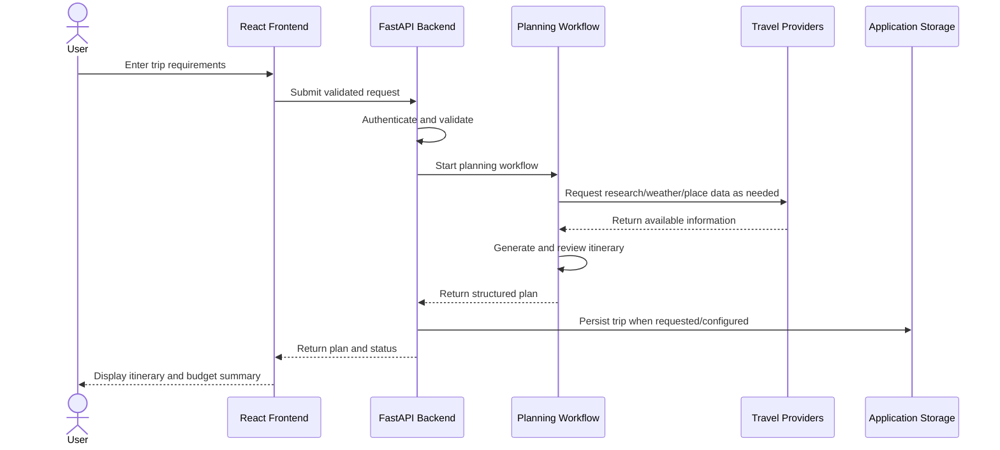

# PACK & GO – AI-Powered Smart Travel Planning Platform

> **Grevix AfterCode | Problem Statement & Software Requirements Specification (SRS)**

PACK & GO is an AI-powered travel planning platform designed to make trip planning more personalized, organized, and practical. Instead of relying on a single generic AI-generated itinerary, the project brings itinerary generation together with budget planning, weather information, place research and map links, packing assistance, expense management, and contextual travel support.

The original Phase 1 hackathon registration idea described a workflow that understands user preferences, researches the destination, considers weather and budget constraints, generates an itinerary, and refines the plan based on user requirements. Retrieval-Augmented Generation (RAG) was included in the project vision for context-aware assistance grounded in relevant travel knowledge.

The original 24-hour hackathon MVP goals were AI-powered itinerary generation, personalized recommendations, budget and weather integration, and an interactive travel dashboard. These are the registered goals, not a claim that every proposed integration or capability is complete. This README preserves that original context and separately identifies Phase 2 capabilities verified in the repository.

---

## 1. Hackathon Problem Statement & Project Vision

Planning a trip often requires travellers to move between multiple disconnected tools to research destinations, compare attractions, estimate costs, check weather, arrange daily activities, prepare packing lists, and coordinate with other travellers. This process is time-consuming and can result in unrealistic schedules, overlooked constraints, inconsistent information, and budgets that are difficult to manage.

Generic itinerary generators may return a list of popular places without sufficiently considering a traveller’s interests, trip duration, spending limit, weather conditions, travel pace, or practical constraints. Recommendations may also lack supporting context, while changes to one part of a trip can require the user to manually revise the rest of the plan.

**Problem to solve:** How might we build an intelligent travel-planning platform that turns a traveller’s goals and constraints into a personalized, practical, budget-aware trip plan while bringing research, weather, maps, packing, expenses, and contextual assistance into one experience?

### 1.1 Target users

- **Solo travellers** who want a personalized itinerary without researching every detail manually.
- **Friends and families** who need a shared plan and a way to coordinate preferences and decisions.
- **Budget-conscious travellers** who need estimated costs and visibility into spending.
- **First-time visitors** who need destination research and contextual travel guidance.
- **Trip organizers** who need to keep schedules, packing, expenses, and logistics together.

### 1.2 Key challenges

| Challenge | Effect on travellers | Proposed response |
|---|---|---|
| Fragmented research | Information is scattered across multiple services | Centralize travel planning and supporting utilities in one dashboard |
| Generic itineraries | Plans may not reflect personal interests or constraints | Collect preferences and use a multi-step AI planning workflow |
| Unclear trip costs | Travellers may underestimate daily or total spending | Estimate costs and expose a budget breakdown |
| Weather uncertainty | Outdoor activities may be unsuitable for the conditions | Include weather information in planning and trip review |
| Inefficient schedules | Places may be arranged without considering time or travel order | Organize activities by day and support route/sequence optimization |
| Packing uncertainty | Important items can be forgotten | Generate a packing checklist based on trip context |
| Context gaps in AI answers | Generic answers may miss relevant travel information | Retrieve relevant knowledge before generating contextual responses |
| Group coordination overhead | Choices, tasks, and expenses can become difficult to track | Provide shared trip collaboration features |

### 1.3 Original Phase 1 workflow and 24-hour MVP

The Phase 1 vision was to coordinate several planning steps rather than return a single generic itinerary:

1. Understand the traveller's destination, dates or duration, interests, budget, and travel preferences.
2. Research relevant destinations and activities.
3. Consider budget and weather constraints while assembling a day-wise itinerary.
4. Review and refine the plan against the traveller's requirements.
5. Use RAG to provide contextual travel assistance from relevant knowledge.

Within the original 24-hour hackathon, the MVP objective was to demonstrate AI itinerary generation, personalized travel recommendations, budget and weather integration, and an interactive travel dashboard. These goals describe the registration idea; Section 4.3 records the additional Phase 2 work verified in this repository. The requirements and workflows in this SRS describe intended behavior and should not, by themselves, be read as proof that every feature or external integration is enabled.

## 2. Proposed Solution

PACK & GO provides a unified travel workspace. A user enters a destination, travel dates or duration, budget, interests, travel style, and other preferences. The planning workflow uses this context to research the destination, consider weather and budget constraints, generate a day-by-day itinerary, estimate expenses, and refine the result. The traveller can review the plan, request changes, save the trip, and use supporting travel tools from the same platform.

The proposed experience is organized around five principles:

1. **Personalization:** plans should reflect the traveller’s preferences and constraints.
2. **Practicality:** itinerary suggestions should consider duration, budget, weather, and activity order.
3. **Explainable planning flow:** specialized steps should make it easier to understand how a plan is assembled and refined.
4. **Contextual assistance:** answers should use relevant travel knowledge when available.
5. **One travel workspace:** itinerary, expenses, packing, utilities, and collaboration should be accessible together.

## 3. Objectives and Expected Outcomes

- Generate structured, day-wise travel itineraries from user inputs.
- Adapt recommendations to destination, duration, budget, interests, and travel preferences.
- Present an estimated trip cost and a useful budget breakdown.
- Surface relevant weather and destination information to support planning decisions.
- Allow users to review, revise, and save trip plans.
- Provide packing assistance and trip utilities in the planning workflow.
- Support contextual travel questions using a retrieval-based knowledge pipeline.
- Provide a shared workspace for group planning, coordination, and expense tracking.

## 4. Scope

### 4.1 Core scope for the original Phase 1 MVP

- Travel request and preference collection.
- AI-assisted itinerary generation.
- Personalized destination and activity recommendations.
- Budget estimation and cost breakdown.
- Weather information within the planning experience.
- Interactive dashboard to review the generated plan.
- Ability to revise the plan through additional user instructions.

### 4.2 Extended platform scope

- Account and preference management.
- Saved trip management.
- Place and destination research.
- Packing checklist and travel utilities.
- Currency conversion and expense tracking.
- Route or visit-order optimization.
- RAG-powered travel knowledge and contextual Q&A.
- Group trip invitations, members, proposals, voting, decisions, chat, and shared checklists.
- Trip journal and administrative knowledge-management functions.

### 4.3 Phase 2 implementation verified in the repository

| Area | What is implemented | User problem addressed and experience |
|---|---|---|
| Offline Travel Vault | An authenticated Offline Vault lists locally saved trips. From an online trip detail page, a user can choose **Save for Offline**; the app stores a trip snapshot in browser IndexedDB and can load that snapshot when the trip API request is unavailable. | Keeps a saved itinerary and its available trip details accessible on the same device during a connection loss. The Vault shows the saved time and the trip details available in the snapshot; it does not synchronize changes made while offline. |
| Offline trip snapshots and freshness | A trip snapshot includes available itinerary, budget, date, preference, review, and weather data; separate weather and place snapshots are created only when those data are present. Records track save/update timestamps. Freshness rules define time-to-live values of 6 hours for weather, 30 days for guides, and 7 days for places and routes; trip snapshots have no expiry. The Vault currently surfaces a fresh/stale label for weather. | Helps travellers understand what trip context is stored locally and whether cached weather may need checking again. Guide and route record types exist in storage, but this trip-save flow does not populate them. |
| PWA shell and offline behavior | The frontend includes a web app manifest and registers a service worker in production builds. The worker attempts to precache the application shell, uses a network-first strategy for navigations with the cached app shell as a fallback when available, and caches eligible same-origin static assets. API and other backend requests are excluded from its cache rules. | Allows the application shell and cached static resources to open without a network connection after they have been cached. The fallback is the app shell, not a separate offline page; live API-backed features remain unavailable offline. |
| Supabase authentication and MongoDB setup | The frontend uses Supabase Auth with a public anonymous key and persisted browser sessions. The backend validates bearer tokens through Supabase and maintains user profiles in MongoDB. MongoDB configuration is explicit, connection initialization pings the server and creates indexes, and connection failures are surfaced with sanitized messages. | Makes the authentication and application-data configuration explicit and avoids presenting a failed database connection as a successful operation. Access to saved trips still depends on online authentication and backend access; locally saved snapshots are a separate read-only fallback. |
| Tests and developer configuration | `.env.example` provides placeholder variable names for backend, frontend, provider, and RAG/storage configuration. Vite is configured to load the repository-root environment and proxy the local health, planning, and API paths. The repository includes focused frontend tests for offline storage, snapshots and freshness, plus backend tests for Supabase auth and MongoDB configuration. | Gives contributors a non-secret configuration reference and automated checks around the new offline and backend configuration behavior. Test files are present; this README does not claim a test-run result. |

## 5. Stakeholders and User Roles

| Role | Needs and responsibilities |
|---|---|
| Visitor | Understand the platform and access public discovery or authentication entry points |
| Traveller | Enter trip requirements, generate plans, manage preferences, and review travel information |
| Trip owner/organizer | Create a shared trip, invite participants, and coordinate the group plan |
| Group member | Review shared trip details and participate in permitted collaboration activities |
| Administrator | Manage designated administrative functions and knowledge sources |
| External service/provider | Supply model responses or supporting data such as weather, places, maps, or currency rates |

## 6. Functional Requirements

### FR-01 — Travel request input

The system shall collect the information needed to begin planning, including destination, trip duration or dates, budget, interests, and relevant travel preferences. Where essential information is missing, the interface should allow the user to provide or clarify it.

**Expected result:** a structured travel request that can be passed to the planning workflow.

### FR-02 — Preference-aware planning

The system shall use the traveller’s stated interests, travel style, budget, duration, and other available preferences to guide destination recommendations and itinerary generation.

**Expected result:** suggestions are relevant to the submitted request rather than a generic list of attractions.

### FR-03 — AI itinerary generation

The system shall generate a day-wise itinerary with activities organized into a readable sequence. Each itinerary item should include useful details where available, such as place/activity name, description, suggested timing, and estimated cost.

**Expected result:** a structured plan that the traveller can review and refine.

### FR-04 — Destination research

The system shall support destination and place research to provide relevant information for itinerary choices. Search results and generated recommendations should be presented clearly, with external information identified where applicable.

### FR-05 — Budget estimation

The system shall estimate trip expenses from the available trip inputs and activity information. Where sufficient data exists, the system should summarize expected costs by category or day and compare the estimate with the user’s budget.

**Expected result:** a visible cost estimate that helps the traveller judge whether the plan is financially practical.

### FR-06 — Weather-aware planning

The system shall retrieve or present relevant weather information when the configured provider is available. Weather information should help users evaluate outdoor activities and decide whether an itinerary needs adjustment.

### FR-07 — Itinerary revision

The system shall allow the traveller to request changes, such as changing the budget, duration, interests, or activities. The planning workflow should use the revised constraints to regenerate or update the plan where supported.

### FR-08 — Plan review and persistence

The platform shall provide an interactive view of the itinerary and support saving and retrieving trip information for authenticated users where configured.

### FR-09 — Packing assistance

The platform shall support a packing checklist informed by trip context, such as destination, duration, weather, and planned activities. Users should be able to review items and track their packing progress where the checklist interface is available.

### FR-10 — Map, place, and route utilities

The platform shall expose place-related information and map or route assistance where a suitable provider or integration is configured. The user should be able to inspect trip locations and use route or visit-order tools where supported.

### FR-11 — Contextual travel Q&A with RAG

The system shall support a retrieval-based question-answering workflow. Relevant travel documents or knowledge content are processed, indexed, retrieved for a user question, and supplied as context to the answer-generation step.

**Expected result:** responses informed by retrieved material when relevant content is available, rather than relying only on an unconstrained model response.

### FR-12 — Travel utilities

The platform shall make relevant trip utilities available from the travel workspace. These may include currency conversion, weather lookup, place search, route assistance, and expense calculations according to configured integrations.

### FR-13 — Expense management

The platform shall support recording trip expenses and presenting summaries. For group trips, expense visibility and permitted actions should follow the trip’s access rules.

### FR-14 — Group planning and coordination

The extended platform shall support shared trip workspaces with member management and invitations. Where enabled, members can discuss options, submit proposals, vote, record decisions, use shared checklists, and view notifications.

### FR-15 — Trip journal

The platform shall provide a place to record trip notes or memories and associate them with a trip where the journal feature is enabled.

### FR-16 — Authentication and access control

Private trip and profile operations shall require authentication. Server-side authorization shall determine whether a user may access or modify a resource; hiding a control in the frontend alone shall not be treated as authorization.

### FR-17 — Administrative functions

Designated administrative interfaces shall be restricted to authorized administrators. Administrative actions should be validated and logged where supported.

## 7. Non-Functional Requirements

| ID | Requirement | Description |
|---|---|---|
| NFR-01 | Usability | The user should be able to enter trip requirements and understand the resulting itinerary without needing technical knowledge. |
| NFR-02 | Responsiveness | The interface should present progress and results clearly during longer planning operations where streaming is supported. |
| NFR-03 | Modularity | Frontend, API, AI agents, tools, services, and data access should remain logically separated. |
| NFR-04 | Security | Secrets must be kept out of source control; protected resources require authentication and authorization. |
| NFR-05 | Reliability | External-provider failures and invalid inputs should be handled with useful errors where implemented. |
| NFR-06 | Maintainability | Features should be organized into reusable components and services. |
| NFR-07 | Extensibility | New agents, travel utilities, and data providers should be addable without redesigning the whole application. |
| NFR-08 | Data integrity | User and trip records should preserve ownership and consistency through validated operations and database constraints where configured. |
| NFR-09 | Privacy | User-specific trip details and group data should only be accessible to authorized users. |
| NFR-10 | Transparency | Estimated prices, weather, and generated recommendations should be treated as planning assistance and may require user verification. |

## 8. User Journeys and End-to-End Workflows

### 8.1 Primary journey: plan a trip

1. The user opens PACK & GO.
2. The user enters a destination, duration or dates, budget, interests, and travel preferences.
3. The application validates the request and passes it to the backend planning endpoint.
4. The AI workflow interprets the request and gathers relevant destination information.
5. Weather and budget-related information are considered when the required integrations are available.
6. The itinerary agent assembles a day-wise plan.
7. A review/critic step evaluates the plan against the supplied constraints and requests refinement when supported.
8. The backend returns the structured plan and relevant cost information.
9. The frontend presents the plan in an interactive dashboard.
10. The user reviews the result, requests changes, and saves the trip where persistence is enabled.

### 8.2 Change a trip constraint

When the traveller changes an important constraint—such as budget, trip length, or interests—the application should pass the updated information into the revision workflow. The plan should be updated or regenerated according to the available functionality. The revised result should be shown to the user for review rather than silently replacing their intent.

### 8.3 Ask a contextual travel question

1. The user submits a question in the knowledge or travel-assistance interface.
2. The backend prepares the query for retrieval.
3. The RAG pipeline searches the configured knowledge index for relevant content.
4. Retrieved context is provided to the language model.
5. The answer is returned to the interface, with source context or citations where supported.

### 8.4 Group trip coordination

1. An authorized trip owner creates or opens a shared trip.
2. The owner invites participants using the configured invitation mechanism.
3. Participants accept the invitation and access the trip according to their permissions.
4. Members review the shared itinerary and contribute proposals or comments where enabled.
5. Members vote on proposed options and record decisions where the collaboration workflow supports it.
6. The group uses shared checklists, chat, notifications, and expense tracking as available.

## 9. AI Planning Architecture

PACK & GO uses a coordinated workflow rather than treating travel planning as a single prompt. Specialized agents and tools divide the work into smaller responsibilities. The supervisor/workflow coordinates these steps and combines their results into the final response.

### 9.1 Agent responsibilities

| Agent or component | Responsibility |
|---|---|
| Supervisor / workflow | Interpret the request, coordinate the planning stages, and manage control flow |
| Research agent | Gather destination and activity context using configured search or place tools |
| Preference extractor | Identify relevant user constraints and preferences from the request |
| Itinerary agent | Produce a structured day-wise plan |
| Budget agent | Estimate or organize trip costs against the user’s spending limit |
| Weather agent | Retrieve and interpret available weather information for trip planning |
| Critic / review agent | Review the proposed plan against requirements and identify issues for refinement |
| Knowledge agent | Support travel questions using retrieved knowledge context |
| Tool layer | Provide operations such as place lookup, weather retrieval, currency conversion, and expense calculation |

### 9.2 High-level architecture

### 9.3 Planning workflow

The planning workflow should preserve the user's original constraints as it gathers information and builds the itinerary. Research, weather, cost estimation, itinerary construction, and critique are separate responsibilities so that the workflow can be adjusted or extended. The final plan is returned in a structured form suitable for the frontend to display by day and activity.

### 9.4 Constraint-aware itinerary generation

The platform includes itinerary optimization approaches intended to help organize activities under constraints:

- **Constraint Satisfaction Problem (CSP):** represents planning requirements as constraints and searches for an assignment that satisfies them.
- **Genetic Algorithm (GA):** explores candidate itinerary arrangements and evolves candidates using a fitness measure.
- **Route optimization:** supports improving the order of visits based on the information and constraints available to the route service.

These techniques complement AI-generated suggestions. Their usefulness depends on the completeness and quality of the supplied locations, durations, costs, and constraints.

## 10. Retrieval-Augmented Generation (RAG)

RAG provides a way to answer questions using relevant information from a configured travel knowledge collection. It separates knowledge preparation from question answering.

### 10.1 Knowledge ingestion

1. Receive or select a supported knowledge source.
2. Extract readable text from the source.
3. Split the text into manageable chunks while preserving useful context.
4. Generate embeddings for the chunks.
5. Store vectors and associated metadata in the configured vector store.

### 10.2 Query-time retrieval

1. Receive a user's question.
2. Convert the question into a retrieval representation.
3. Search the vector store for relevant chunks.
4. Assemble retrieved material into the model context.
5. Generate a response based on the question and retrieved material.
6. Return the answer and source information when available.

RAG quality depends on source quality, chunking, retrieval relevance, prompt design, and model behaviour. If relevant context is not available, the system should avoid implying that an answer is supported by a source that was not retrieved.

## 11. Website Information Architecture and Feature Details

The following sections describe the intended responsibilities of the main user-facing areas. Availability of individual functions depends on the configured application environment and integrations.

### 11.1 Landing page

Introduces PACK & GO, explains its travel-planning value, and directs users to discovery or planning entry points.

### 11.2 Authentication

Provides sign-in and account-related flows. Authentication configuration, callback URLs, and server-side token validation are required for protected actions.

### 11.3 Profile and preferences

Allows a traveller to manage profile information and reusable travel preferences. Preference data can be supplied to the planning workflow to reduce repeated input.

### 11.4 AI planner

Collects trip requirements and displays generated plans. The planner is the main entry point for submitting a request, reviewing the itinerary, inspecting cost information, and requesting revisions.

### 11.5 Trips and trip details

Organizes saved trips and presents the itinerary for a selected trip. Trip details can act as the central place for itinerary review and access to related trip tools.

### 11.6 Explore and travel guide

Supports destination discovery and place research. Available results depend on the connected data providers and their coverage.

### 11.7 Group workspace

Organizes participants and shared trip activity. Depending on enabled functionality, this area includes member management, invitations, proposals, voting, decisions, chat, checklists, and notifications.

### 11.8 Expense manager

Records travel expenses and presents summaries to help users understand spending. Currency and totals should be interpreted according to the currency and exchange-rate information available to the application.

### 11.9 Trip journal

Provides a space to preserve trip notes and memories associated with a trip.

### 11.10 Travel utilities

Groups supporting tools such as weather lookup, currency conversion, place information, route assistance, and packing or expense calculations where configured.

### 11.11 Knowledge center

Provides the user interface for travel knowledge sources and contextual question answering. Knowledge ingestion and retrieval depend on backend configuration and supported source formats.

### 11.12 Administration

Provides designated administrative views and knowledge-management actions for authorized users only.

## 12. Group Travel Requirements

Group travel introduces shared state and permission requirements in addition to ordinary trip planning.

### 12.1 Membership and invitations

- A trip owner can invite participants through the configured invitation flow.
- Invitation acceptance must be validated by the backend.
- Membership changes must respect the trip's access policy.
- Shared resources must be scoped to the correct trip and authorized participants.

### 12.2 Proposals, votes, and decisions

- Members can submit proposals where permitted.
- Voting actions must be associated with the correct proposal and authorized member.
- The application should record the resulting decision or decision state.
- The interface should clearly communicate proposal status and recorded outcomes.

### 12.3 Shared communication and checklist

- Members can access trip-related discussion where enabled.
- Shared checklist items help coordinate preparation and tasks.
- Notifications should communicate relevant collaboration events where configured.

### 12.4 Shared expenses

- Expense records should be associated with the correct trip.
- Access and modification should follow membership permissions.
- Summaries should make recorded costs understandable to the group.

## 13. Data Requirements and Conceptual Model

The application needs to associate user-owned information with the correct user and trip. The conceptual entities below describe the information domain rather than prescribing a single physical database implementation.

| Entity | Purpose | Typical relationships |
|---|---|---|
| User | Identity, profile, and preferences | Owns trips and personal settings |
| Trip | Destination, dates/duration, budget, and trip state | Belongs to an owner; may have members, itinerary items, expenses, and journal entries |
| Itinerary item | Activity, place, day, timing, and estimated cost | Belongs to a trip or itinerary |
| Trip member | Membership and role within a shared trip | Connects a user to a trip |
| Invitation | Invitation state and acceptance information | Connects an invitee to a trip |
| Proposal | Suggested activity or group option | Belongs to a trip and may have votes |
| Vote / decision | Group choice and its recorded outcome | Relates to a proposal and trip participants |
| Expense | Cost, category, date, and associated trip | Belongs to a trip and a recording user |
| Checklist item | Preparation or coordination task | Belongs to a trip and may have completion state |
| Journal entry | Trip note or memory | Belongs to a user and/or trip |
| Knowledge source | Document or information source used by RAG | Produces chunks indexed in the vector store |
| Knowledge chunk | Text segment and metadata used for retrieval | Belongs to a source and has an embedding/index entry |

### Conceptual entity relationship diagram

## 14. API and Integration Design

The frontend communicates with the backend through HTTP APIs. The API layer validates requests, applies authentication and authorization where required, invokes business services or AI workflows, and returns structured responses.

### 14.1 API responsibility groups

| API group | Responsibility |
|---|---|
| Trips | Create, retrieve, update, and manage trip records and planning requests |
| Users | Profile and preference operations |
| Collaboration | Group membership, invitations, proposals, votes, decisions, and shared trip activity |
| Expenses | Record and summarize trip expenses |
| Journal | Manage trip journal entries |
| Knowledge | Manage supported knowledge sources and ask contextual questions |
| Utilities | Expose travel-related utility operations such as weather, currency, or place lookup |
| Admin | Provide authorized administrative operations |

### 14.2 External integrations

The platform is designed to use configured external providers for language-model inference, embeddings, weather, place research, maps or routes, currency conversion, and authentication. The exact data available to the application depends on the selected provider, API credentials, usage limits, and network availability.

### 14.3 Integration flow

## 15. Technology Architecture

The project is organized as a web application with a separate frontend and Python backend.

### 15.1 Source structure

| Area | Repository path | Responsibility |
|---|---|---|
| Frontend | `frontend/src/` | React pages, reusable components, API client, authentication, and offline trip storage |
| HTTP API | `api/v1/` | FastAPI route groups for trips, users, collaboration, expenses, journal, knowledge, utilities, and administration |
| AI workflow | `agent/` | Planning supervisor and specialized preference, research, weather, budget, itinerary, critic, and knowledge agents |
| Services and tools | `services/`, `tools/` | Trip and collaboration behavior, itinerary/route algorithms, expenses, and external travel utilities |
| RAG | `rag/` | Knowledge ingestion, chunking, embeddings, retrieval, and response generation |
| Data and migrations | `database/`, `models/`, `alembic/` | Database access, data models, and relational migration support |
| Tests | `tests/`, `frontend/tests/` | Backend Python tests and frontend Node.js tests |

### 15.2 Technology stack

| Layer | Technology / component | Responsibility |
|---|---|---|
| Frontend | React 19, React Router, Vite 8, JavaScript, and CSS | Interactive pages, itinerary display, forms, and trip workspace |
| API backend | Python 3.12+, FastAPI, and Pydantic | HTTP endpoints, request validation, authorization, and service orchestration |
| AI orchestration | LangGraph workflow and specialized agents | Coordinate research, itinerary, budget, weather, review, and knowledge tasks |
| Language-model and travel integrations | Configured Groq/Gemini and travel-data providers | Generate planning responses and supply available place, weather, and currency data |
| RAG and vector storage | Chunking, sentence-transformer embeddings, retrieval, generation, and ChromaDB | Retrieve relevant travel knowledge for question answering |
| Application data and authentication | MongoDB and Supabase Auth | Store application records and verify user identity |
| Relational data tooling | SQLAlchemy and Alembic | Relational database access and schema migration support included in the repository |
| Maps and routes | OpenStreetMap search links and route-optimization utilities | Open place searches and organize itinerary locations where supported |
| Testing | Pytest, Node.js built-in test runner, and Oxlint | Exercise backend and frontend behavior and lint frontend code |

### 15.3 Environment and development configuration

The root `.env.example` is a placeholder reference for configuration; supply local values in an untracked environment file and do not put credentials in source control. Backend configuration includes `SUPABASE_URL`, `SUPABASE_ANON_KEY`, `MONGODB_URI`, `MONGODB_DATABASE`, and `PACK_GO_ALLOWED_ORIGINS`. Frontend configuration uses `VITE_SUPABASE_URL`, `VITE_SUPABASE_ANON_KEY`, and `VITE_API_BASE_URL`. Optional provider and local RAG/storage settings are also represented in the template.

The Vite development configuration reads the repository-root environment and proxies the health, planning, and `/api/v1` requests to the local FastAPI service. Backend tests use Pytest from the repository root; frontend tests use the `npm test` script from `frontend/`.

## 16. Security, Privacy, and Error Handling

- Authentication must be validated before protected operations are performed.
- Server-side authorization must enforce trip ownership, group membership, and administrative roles.
- API keys, database credentials, and private tokens must be supplied through environment configuration and must not be committed to the repository.
- User input should be validated before it reaches AI workflows, database operations, or external providers.
- Errors from model providers and travel APIs should be handled without exposing credentials or internal stack traces to end users.
- Personal and group trip information should not be exposed across unrelated users or trips.
- External data such as weather, route information, and estimated prices may change and should be rechecked when necessary.
- AI-generated itineraries and estimates are decision-support suggestions; travellers should verify time-sensitive information before relying on it.

## 17. Constraints and Assumptions

- The quality of recommendations depends on the completeness of the user’s input and the available destination information.
- Weather, map, place, currency, and model features depend on configured external services and their availability.
- Budget values are estimates unless based on verified live prices.
- Route optimization depends on the locations, travel durations, and constraints available to the system.
- RAG answers depend on the quality, coverage, and relevance of the indexed knowledge sources.
- Group functionality requires reliable identity, membership, and permission checks.
- Long-running AI operations may take time and should communicate progress where streaming is supported.

## 18. Acceptance Criteria

The initial MVP is considered demonstrable when the following core journey can be completed in the configured environment:

1. A traveller can provide a destination, duration, budget, and interests.
2. The application accepts the request and returns a structured itinerary.
3. The itinerary is organized into understandable days and activities.
4. The response includes cost information when sufficient data is available.
5. Weather or destination context is incorporated when the required integration is available.
6. The user can review the result and request a revision.
7. The interface presents the generated plan in a coherent travel dashboard.

The broader platform requirements can be evaluated separately for saved trips, RAG question answering, packing assistance, utilities, expense management, and group collaboration according to the corresponding integrations and flows enabled in the environment.

## 19. Expected Impact

PACK & GO aims to reduce the friction of travel planning by bringing personalized itinerary generation and practical trip organization into one experience. By combining AI planning with budget awareness, weather and destination context, supporting utilities, and collaboration, the platform helps travellers move from a broad idea to a plan they can review, adjust, and use.

The key value is not simply generating a list of places. It is coordinating the information and constraints that make a trip more realistic: **where to go, what to do, when to do it, how much it may cost, what to prepare, and how to adapt the plan when requirements change.**
