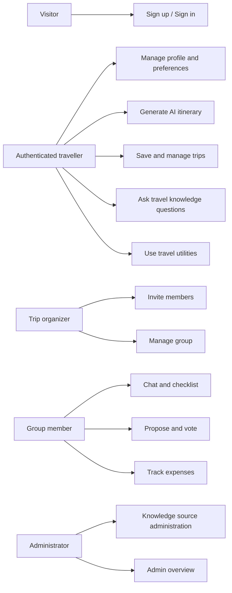
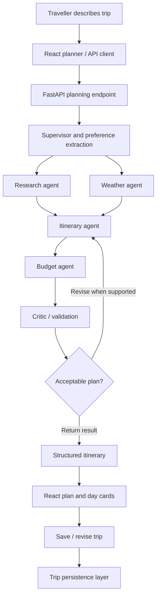
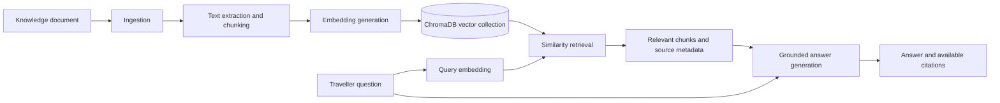
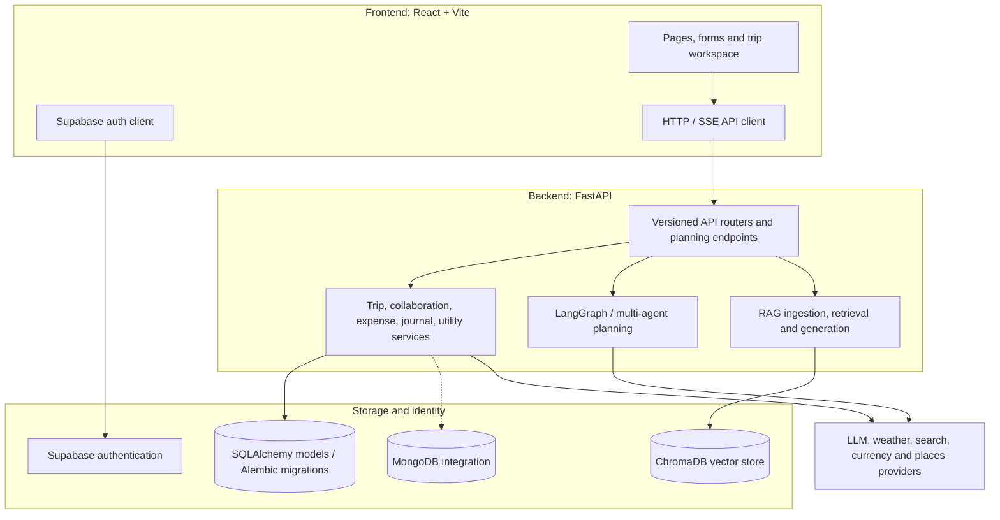
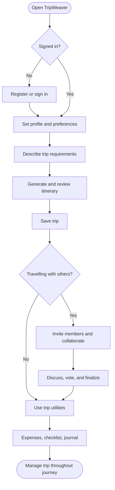
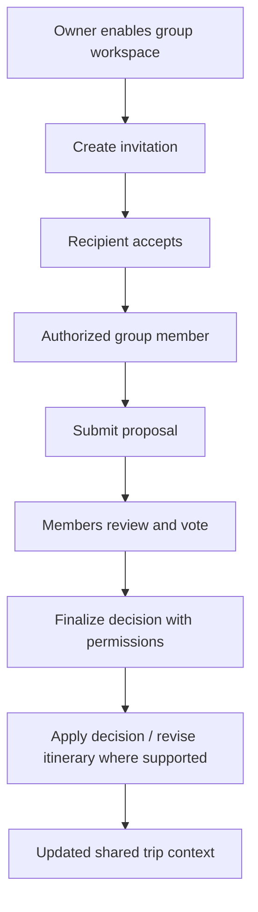
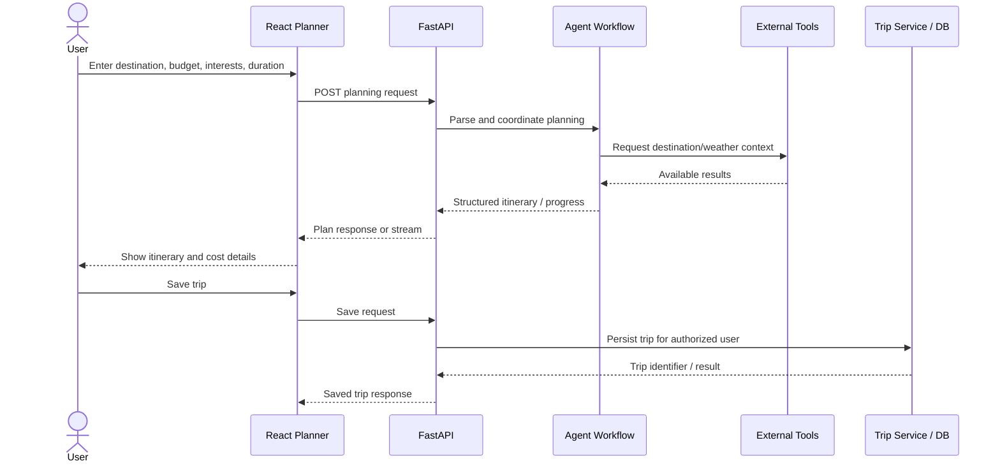
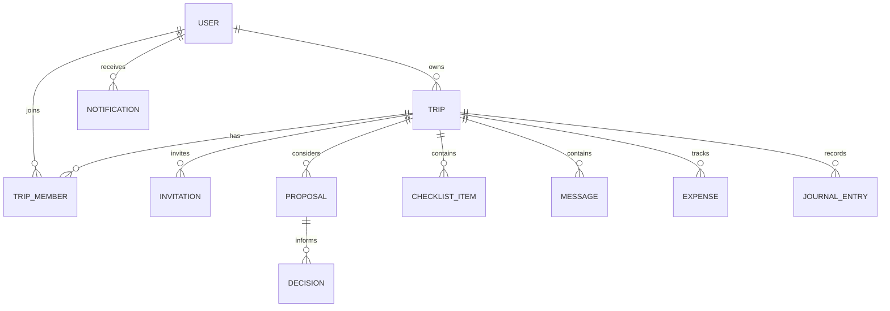

# Grevix AI TripWeaver
### An AI-Powered Multi-Agent Travel Planner and Collaborative Trip Management Platform

**Hackathon:** Grevix AfterCode · **Category:** AI / Full-Stack Web Application · **Repository:** [Grevix_AITripWeaver](https://github.com/patilshrutika1803/Grevix_AITripWeaver) · **Developer:** Shrutika Patil

> **One platform to imagine, plan, optimize, coordinate, and remember a trip.**

## 1. Problem Statement

**Self-selected hackathon problem statement:** *Design an intelligent, collaborative travel-planning platform that converts a traveller's natural-language goals into practical, budget-aware, personalized itineraries while centralizing group decisions, expenses, logistics, and trusted travel information.*

Trip planning is typically fragmented. A traveller researches destinations in one tab, checks weather in another, estimates expenses manually, creates a day-by-day schedule in notes, and coordinates with friends through disconnected chats. This increases planning time and introduces conflicting preferences, duplicated effort, unrealistic schedules, and forgotten decisions.

For group travel, the challenge becomes more complex: people disagree about activities and costs; invitations and responsibilities must be managed; decisions need a clear record; and the itinerary must evolve without losing shared context. AI-generated recommendations also need grounding in relevant travel knowledge instead of relying exclusively on generic responses.

### Who faces this problem?

| Stakeholder | Difficulty | TripWeaver's approach |
|---|---|---|
| Solo traveller | Too many research and planning steps | Natural-language itinerary generation and saved trips |
| Friends and families | Conflicting choices and scattered communication | Group workspace, proposals, voting, chat, decisions |
| Budget-conscious traveller | Hard to estimate and divide spending | Budget-oriented agent, expenses, summaries, currency tools |
| Trip organizer | Manual coordination and follow-up | Invitations, members, checklist, notifications |
| Information seeker | Unstructured, difficult-to-retrieve travel information | RAG-based knowledge ingestion and question answering |

## 2. Proposed Solution

**Grevix AI TripWeaver** is a full-stack travel platform combining a React web application, FastAPI APIs, specialized AI planning agents, a document-grounded retrieval pipeline, and collaboration services. A user describes the destination, duration, interests, group size, and budget; the planning workflow coordinates research, weather, itinerary construction, budget estimation, and critique. The resulting trip can be saved, reviewed, revised, and shared.

**Design principles:** personalization over generic itineraries; collaboration rather than isolated planning; explicit budgets and constraints; persistent trip records; modular AI agents; source-grounded knowledge; secure user-scoped access.

### Objectives and success criteria

| Objective | Expected outcome / acceptance criterion |
|---|---|
| Reduce manual itinerary planning | Accept a travel request and produce structured itinerary output |
| Respect traveller constraints | Capture budget, duration, interests, and relevant preferences |
| Support group decisions | Authorized members can propose options and record votes/decisions |
| Maintain continuity | Users can retrieve, update, and manage saved trips |
| Improve information access | Uploaded knowledge can be chunked, indexed, and queried with source context |
| Enable practical execution | Weather, place lookup, currency, packing, routes, and expense workflows are accessible through the app/API |

## 3. Project Scope and Functional Requirements

The following requirements describe the intended product and the corresponding modules present in the repository. **Module presence does not guarantee a working end-to-end deployment.** See [Implementation and verification](#21-verification-status-and-known-limitations).

| ID | Functional requirement | Relevant modules / interfaces |
|---|---|---|
| FR-01 | Register, sign in, and manage authenticated sessions | `frontend/src/pages/AuthPage.jsx`, `frontend/src/auth/`, `api/v1/users.py` |
| FR-02 | Manage profile and travel preferences | `ProfilePage.jsx`, `PreferencesPage.jsx`, user API |
| FR-03 | Generate an itinerary from natural language | `PlannerPage.jsx`, `agent/`, `/plan` |
| FR-04 | Stream planning progress/results | `agent/agentic_workflow.py`, `/plan/stream`, `AgentTimeline.jsx` |
| FR-05 | Create, view, edit, delete, and regenerate trips | `TripsPage.jsx`, `TripDetailPage.jsx`, `api/v1/trips.py` |
| FR-06 | Research destinations and places | `ExplorePage.jsx`, `TravelGuidePage.jsx`, place search tools |
| FR-07 | Optimize day plans against constraints | `services/itinerary_csp.py`, `services/itinerary_ga.py` |
| FR-08 | Optimize visit order/route | `services/route_optimization.py` |
| FR-09 | Create group trips and manage members | `api/v1/collaboration.py`, `GroupMembers.jsx` |
| FR-10 | Invite participants and accept invitations | `GroupInvitations.jsx`, `InvitationAcceptPage.jsx` |
| FR-11 | Propose activities, vote, and finalize decisions | `GroupProposals.jsx`, `GroupDecisions.jsx` |
| FR-12 | Communicate and coordinate tasks | `GroupChat.jsx`, `GroupChecklist.jsx`, `GroupNotifications.jsx` |
| FR-13 | Record expenses and view summaries | `ExpenseManager.jsx`, `api/v1/expenses.py` |
| FR-14 | Record trip memories and journal statistics | `TripJournal.jsx`, `api/v1/journal.py` |
| FR-15 | Use weather, currency, places, packing, and route tools | `TripUtilities.jsx`, `api/v1/utilities.py` |
| FR-16 | Upload, index, and query travel documents | `KnowledgeCenterPage.jsx`, `rag/`, `api/v1/knowledge.py` |
| FR-17 | Provide restricted administration functions | `AdminDashboardPage.jsx`, `api/v1/admin.py` |

### Non-functional requirements

| ID | Requirement | Design consideration |
|---|---|---|
| NFR-01 | Security | Token-based authentication, authorization checks, protected routes, secrets outside Git |
| NFR-02 | Maintainability | Separate frontend, API, services, agents, tools, and data access |
| NFR-03 | Reliability | Validation, error handling, retries where implemented, automated tests |
| NFR-04 | Responsiveness | React UI and streaming support for long-running planning |
| NFR-05 | Extensibility | Replaceable providers and modular planning agents |
| NFR-06 | Data integrity | Persistent models, migrations, ownership and transaction tests |
| NFR-07 | Observability | Logging and explicit health/error checks; further improvements planned |

## 4. Actors, Roles, and Access

- **Visitor:** views public landing/explore experiences and navigates to authentication.
- **Authenticated traveller:** edits preferences, generates plans, manages owned trips, and uses trip utilities.
- **Trip owner/organizer:** configures a group trip, invites others, and manages membership and decisions subject to server-side authorization.
- **Group member:** accesses shared trip information and participates in permitted discussions, proposals, votes, and tasks.
- **Administrator:** accesses restricted overview and knowledge administration endpoints.
- **External systems:** AI model providers, place/weather/currency services, Supabase, application databases, and vector storage.

### Use-case diagram



## 5. Website Pages and Detailed Feature Specification

### 5.1 Landing page — `LandingPage.jsx`

**Purpose:** introduce the product, explain the planning value proposition, and direct visitors toward exploring destinations or starting a plan. The interface includes a hero section, navigation, and footer components. **User path:** land on the homepage → understand the platform → sign in or proceed to available discovery/planning pages.

### 5.2 Authentication and password recovery — `AuthPage.jsx`, `ForgotPasswordPage.jsx`

**Purpose:** create a user identity and maintain authenticated access. Supabase client/session logic lives under `frontend/src/auth/`. The API client attaches the appropriate session token for protected calls. Protected routes gate private pages, while backend checks remain authoritative. Password recovery has a dedicated UI. **Dependencies:** correctly configured Supabase URL and public anon key, valid callback settings, and backend token verification.

### 5.3 Profile and preferences — `ProfilePage.jsx`, `PreferencesPage.jsx`

**Purpose:** store user details and reusable travel choices rather than repeating them in every request. Preference data is designed to inform personalization. The backend exposes user/profile/preferences operations; the frontend provides corresponding screens. **Typical flow:** authenticate → open profile/preferences → review or edit → save → reuse on subsequent planning requests.

### 5.4 AI planner — `PlannerPage.jsx`

**Purpose:** turn a natural-language travel request into a structured travel plan. The user supplies trip intent such as destination, dates or duration, budget, interests, travel style, and companions. The frontend sends the request to the FastAPI planning endpoint. The multi-agent backend coordinates specialized responsibilities and produces itinerary output, with a streaming path for progress updates. Components include `ChatInput`, `MessageBubble`, `AgentTimeline`, `PlanCard`, `DayCard`, and `CriticScore`.

**Expected itinerary elements:** destination context, day-wise activities, visit sequencing, estimated cost considerations, relevant weather/places, and reviewable recommendations. Exact response fields depend on the active Pydantic schema and agent output.

**User flow:** enter request → submit → agents research/compose/check → inspect generated days and costs → save or revise trip → open saved trip. Failure conditions include missing LLM/provider credentials, external API rate limits, malformed model responses, or unavailable persistence.

### 5.5 Explore and travel guide — `ExplorePage.jsx`, `TravelGuidePage.jsx`

**Purpose:** help users discover destinations and contextual travel information. Place-search tools support relevant discovery. The guide view is intended to bring travel guidance into a single interface. External search results and map links depend on configured providers; a fully embedded map is **not guaranteed** by the current code.

### 5.6 Saved trips and trip detail — `TripsPage.jsx`, `TripDetailPage.jsx`

**Purpose:** provide continuity between planning sessions. The trip service and trip API support listing, creating, retrieving, updating, and deleting trip records, plus itinerary-day revision. Trip detail acts as the hub for itinerary review, group collaboration, expenses, journal, and utilities. **Access rule:** the backend should enforce ownership or authorized membership, not rely solely on hidden frontend buttons.

### 5.7 Group workspace — `GroupOverview.jsx`, `GroupMembers.jsx`

**Purpose:** transform an individual itinerary into a coordinated group experience. The workspace provides shared trip context and membership management. Supported backend concepts include group activation, members, roles, ownership transfer, leaving/removing members, and permission checks. Owner/member actions must be authorized server-side.

### 5.8 Invitations — `GroupInvitations.jsx`, `InvitationAcceptPage.jsx`

**Purpose:** let the organizer invite companions without manually copying plans between applications. Invitation APIs support creation, listing, preview, acceptance, and revocation; the repository also contains migration support for link invitations. **Flow:** organizer creates invite → recipient opens link → signs in if needed → backend validates invitation and permissions → membership is recorded → group workspace becomes accessible. Expired/revoked/invalid invitations should produce an explicit error state.

### 5.9 Proposals, voting, and decisions — `GroupProposals.jsx`, `GroupDecisions.jsx`

**Purpose:** resolve disagreements transparently. Members can propose itinerary options, vote, review results, and finalize a decision according to permitted roles. The backend contains decision snapshots and related schema migrations. A finalized decision may be applied to the trip/replanning workflow. **Value:** avoids losing group consensus inside informal chats.

### 5.10 Group chat, checklist, and notifications

`GroupChat.jsx` provides shared conversation; `GroupChecklist.jsx` tracks preparation tasks and completion state; `GroupNotifications.jsx` surfaces updates and unread items. Together these support day-to-day coordination: discuss an option, assign/complete preparation items, and see changes without switching apps. Data consistency and access control depend on the collaboration API and database.

### 5.11 Expense manager — `ExpenseManager.jsx`

**Purpose:** record trip spending and make costs visible to the group. Expense services/API cover create, list, update, delete, and summary operations. The feature is intended for budget awareness and shared visibility; **do not assume automatic bank integrations or payment settlement**, which are not established by the supplied code overview.

### 5.12 Travel journal — `TripJournal.jsx`

**Purpose:** preserve trip experiences alongside the itinerary. The journal API and service support journal entries, edits/deletion, and statistics. Journal content belongs to the trip context and must be subject to appropriate authorization.

### 5.13 Travel utilities — `TripUtilities.jsx`

Utilities include weather lookup, currency conversion, place search, route-related data, packing lists, and route optimization. These are assistance tools rather than guaranteed live booking integrations. The project has tools under `tools/`, implementations under `utils/`, and API endpoints under `api/v1/utilities.py`. Provider-backed results can be limited by credentials, coverage, freshness, and quota.

### 5.14 Knowledge center and RAG — `KnowledgeCenterPage.jsx`

**Purpose:** answer questions using indexed travel documents rather than relying on a model's general memory alone. The repository contains modules for ingestion, chunking, embeddings, vector storage, retrieval, and answer generation, plus evaluation utilities and citation tests. Administrative ingestion and user-facing question answering are separate responsibilities. **Prerequisite:** documents must actually be indexed into a working collection; empty/unavailable vector storage cannot provide grounded answers.

### 5.15 Admin dashboard — `AdminDashboardPage.jsx`

**Purpose:** provide restricted operational oversight. The backend includes admin analytics and knowledge-source management. Administrative privileges must be verified by the server. Dashboard metrics are dependent on real database records and should not be presented as verified live analytics until tested.

## 6. AI System Design: Multi-Agent Planning

The repository separates the planning workflow into agents with distinct responsibilities:

| Agent/module | Responsibility |
|---|---|
| `supervisor.py` | Coordinates planning intent and agent execution |
| `preference_extractor.py` | Extracts useful user preferences/constraints from the request |
| `research_agent.py` | Collects destination and activity context using available tools |
| `weather_agent.py` | Incorporates weather context where provider data is available |
| `itinerary_agent.py` | Assembles structured day-by-day travel suggestions |
| `budget_agent.py` | Evaluates costs and budget fit |
| `critic_agent.py` | Reviews output quality and constraints |
| `knowledge_agent.py` | Connects planning/question answering to available knowledge |
| `chat_agent.py` | Supports conversational planning interactions |
| `agentic_workflow.py` | Wires agent execution and workflow state |

### Planning workflow



This diagram represents the **conceptual responsibilities and target workflow**, not a claim that every branch or feedback loop is exercised in the current deployment.

### Planning and optimization algorithms

**Constraint Satisfaction (CSP):** `services/itinerary_csp.py` contains constraint-based itinerary logic intended to satisfy limits such as feasible activity choices, timing, and plan restrictions. **Genetic Algorithm (GA):** `services/itinerary_ga.py` provides an optimization approach using candidate itineraries and iterative search. **Route optimization:** `services/route_optimization.py` handles ordering/route-related optimization. The repository contains dedicated unit/API tests for all three areas. Their exact constraints, objective functions, and production outcomes should be checked against those modules before making benchmark claims.

## 7. Retrieval-Augmented Generation (RAG) Architecture



**Ingestion path:** validate source → extract content → split into chunks → embed chunks → store vectors and source metadata. **Query path:** embed the question → retrieve similar chunks → assemble context → generate an answer → return citation/source information when supported. Relevant implementation files: `rag/ingestion.py`, `chunking.py`, `embeddings.py`, `vector_store.py`, `retrieval.py`, `generation.py`, and `api/v1/knowledge.py`.

**Limitations:** answers depend on ingested documents, retrieval relevance, provider access, and persistent vector storage. A local ChromaDB directory is not automatically durable on ephemeral cloud hosting.

## 8. Overall System Architecture



**Persistence clarification:** this repository contains both relational persistence (`database/connection.py`, `database/models.py`, Alembic migrations; local SQLite fallback) and a MongoDB module (`database/mongodb.py`). MongoDB integration and migration documents exist, but a fully completed MongoDB-only migration is **not verified**. The architecture deliberately shows both rather than claiming a single fully operational datastore.

### Layer responsibilities

| Layer | Main responsibilities | Code location |
|---|---|---|
| Presentation | Page navigation, forms, trip cards, group workspace, status messages | `frontend/src/` |
| API | Request parsing, auth dependencies, response schemas, routing | `main.py`, `api/v1/`, `models/` |
| Domain services | Trip persistence, group decisions, expenses, journals, utilities | `services/` |
| Intelligence | Agent orchestration, prompts, tools, itinerary optimization | `agent/`, `prompt_library/`, `tools/` |
| Knowledge | Document ingestion, embeddings, vector retrieval, generation | `rag/`, `evaluation/` |
| Persistence | Database connection, data models, migrations, Mongo integration | `database/`, `alembic/` |
| Testing | Backend and frontend tests | `tests/`, `frontend/tests/` |

## 9. Core Process Flowcharts

### 9.1 End-to-end user journey



### 9.2 Group decision lifecycle



### 9.3 Sequence diagram: itinerary generation



## 10. Data Model and Relationships

The relational schema and migrations include these domain entities: users, trips, group members, invitations, proposals, decisions, checklist items, messages, notifications, expenses, journal entries, and knowledge sources. The diagram below is a **high-level logical model**, not an exact foreign-key export.



**Data ownership:** private trips are associated with an authenticated identity; group data must be checked against membership and role permissions. **Lifecycle:** create trip → optionally activate group → invite members → coordinate proposals/tasks → track expenses and journal → update or delete according to permissions. **Schema evolution:** migration scripts live in `alembic/versions/`; MongoDB mapping notes live in `docs/MONGODB_MIGRATION_MAPPING.md`.

## 11. Technology Stack

| Concern | Technology / approach |
|---|---|
| Frontend | React, Vite, React Router, JavaScript/JSX, CSS |
| Backend | Python, FastAPI, Pydantic, Uvicorn |
| AI orchestration | LangGraph/LangChain-style agents and tool calling |
| Retrieval | ChromaDB, embeddings, chunking, retrieval, RAG generation |
| Identity | Supabase authentication |
| Relational data | SQLAlchemy, Alembic, SQLite fallback / configured database |
| Additional data integration | MongoDB driver/integration module; connectivity to verify |
| Travel information | External LLM, search, weather, currency, and place APIs |
| Quality | Pytest, frontend Node test scripts, production build checks |
| Deployment targets | Vercel-compatible frontend, Render-compatible FastAPI backend |

## 12. Repository Structure

```text
Grevix_AITripWeaver/
├── agent/              # Supervisor, research, weather, itinerary, budget, critic, chat
├── api/v1/             # Users, trips, collaboration, expenses, journal, knowledge, utilities, admin
├── config/             # Application configuration
├── database/           # Database connection, relational models, MongoDB integration
├── alembic/            # Schema migrations
├── docs/               # RAG, optimization, group architecture, deployment audits
├── evaluation/         # RAG evaluation cases, metrics, runners
├── frontend/
│   ├── src/pages/      # Landing, auth, planner, trips, profile, guide, admin, knowledge
│   ├── src/components/ # Plan cards, utilities, expenses, journal, group workspace
│   ├── src/auth/       # Supabase client and auth context
│   └── tests/          # Frontend unit tests
├── memory/             # Short/long-term agent memory modules
├── models/             # API and agent schemas
├── prompt_library/     # Prompt templates for specialized agents
├── rag/                # Ingestion, chunking, embeddings, vector store, retrieval
├── services/           # Domain services, CSP/GA, route optimization
├── tests/              # Backend and integration-oriented tests
├── tools/              # Search, weather, currency, arithmetic and expense tools
├── utils/              # Shared helpers and streaming
├── main.py             # FastAPI application entry point
├── requirements.txt
└── README.md
```

## 13. API Design and Integration

**Base local API:** `http://127.0.0.1:8000`. **Interactive documentation:** `/docs` (when the backend is running). The backend contains planning endpoints such as `POST /plan` and `POST /plan/stream` plus versioned routers under `api/v1/` for trips, users, collaboration, expenses, journal, knowledge, utilities, and admin. The precise methods, parameters, and paths should be taken from the running OpenAPI schema rather than inferred from the frontend alone.

**Request lifecycle:** browser → authenticated API client → FastAPI route → validation and permission dependency → domain service/agent → database or provider → serialized response → React UI. Streaming requests additionally require a correctly configured stream transport and frontend reader.

---

## 14. Local Setup

### Prerequisites

-   Git
-   A compatible Python version
-   Node.js and npm compatible with `frontend/package.json`
-   MongoDB Atlas or an approved isolated MongoDB test instance
-   Supabase project
-   API credentials for the external features you intend to test

### Clone the repository

``` bash
git clone https://github.com/patilshrutika1803/Grevix_AITripWeaver.git
cd Grevix_AITripWeaver
```

If already cloned, open the existing project folder instead.

### Create a Python virtual environment (Windows CMD)

``` cmd
py -3.12 -m venv .venv
.venv\\Scripts\\python.exe -m pip install --upgrade pip
.venv\\Scripts\\python.exe -m pip install -r requirements.txt
```

PowerShell users can activate the environment with `..\\.venv\\Scripts\\Activate.ps1` from the repository root if desired. The commands above avoid shell activation and call the virtual-environment Python directly.

### Install frontend dependencies

``` cmd
cd frontend
npm ci
cd ..
```

Configure the ignored root `.env` file with the required local settings.
Use an example template only if one exists in the checked-out branch.
Never commit `.env` or paste secrets into issues/chat.

## 15. Environment Variables

Variable requirements depend on the actual code paths enabled. Verify
usage before renaming or deleting variables.

### Backend --- root `.env`

``` dotenv
PACK_GO_ENV=development
PACK_GO_ALLOWED_ORIGINS=http://localhost:5173,http://127.0.0.1:5173

# Supabase
SUPABASE_URL=
SUPABASE_ANON_KEY=
# Only if required by the active backend auth/admin path; backend-only.
SUPABASE_SERVICE_ROLE_KEY=

# MongoDB
MONGODB_URI=
MONGODB_DATABASE=pack-go

# AI/search providers
GROQ_API_KEY=
GOOGLE_API_KEY=
TAVILY_API_KEY=

# Travel utilities
OPENWEATHERMAP_API_KEY=
EXCHANGE_RATE_API_KEY=
```

### Frontend public build-time configuration

The current Vite configuration loads the root environment and maps the
public Supabase URL to the name expected by the frontend client. Verify
`frontend/vite.config.js` before changing that arrangement.

Common public variables:

``` dotenv
SUPABASE_URL=
VITE_SUPABASE_ANON_KEY=
VITE_API_BASE_URL=
```

-   During local development, the Vite proxy may forward requests to
    `http://127.0.0.1:8000`.
-   In Vercel, set `VITE_API_BASE_URL` to the deployed backend origin if
    the production API client requires it.
-   Local ignored `.env` files are not automatically present in Vercel
    or Render.
-   `MONGODB_URI`, provider secrets, and `SUPABASE_SERVICE_ROLE_KEY`
    must never be exposed in the frontend bundle or assigned a `VITE_`
    prefix.

Checklist: - \[ \] `.env` is ignored by Git. - \[ \] MongoDB
URI/database are configured on the backend. - \[ \] Supabase public
URL/anon key are configured for frontend builds. - \[ \] Backend token
validation matches the current auth implementation. - \[ \] Provider
keys are set for features being tested. - \[ \] Allowed origins include
the actual frontend origin. - \[ \] Production secrets are configured in
the backend host. - \[ \] Vercel build variables are configured
independently from local `.env`.

## 16. Run Locally

Run backend and frontend in separate terminals.

### Terminal A --- FastAPI backend

From the repository root in Windows CMD:

``` cmd
.venv\\Scripts\\python.exe -m uvicorn main:app --reload --host 127.0.0.1 --port 8000
```

Local API base:

``` text
http://127.0.0.1:8000
```

### Terminal B --- frontend

``` cmd
cd frontend
npm run dev
```

Use the URL printed by Vite, commonly `http://localhost:5173`.

### Useful URLs

  Purpose               URL
  --------------------- --------------------------------------
  Frontend              `http://localhost:5173`
  FastAPI Swagger UI    `http://127.0.0.1:8000/docs`
  OpenAPI JSON          `http://127.0.0.1:8000/openapi.json`
  Graph visualization   `http://127.0.0.1:8000/graph`

The `/` or `/health` route may return 404 if it is not defined. Use
`/docs` and routes shown by the running OpenAPI schema to verify the
API.

### Read-only MongoDB ping

Run from the repository root in a separate terminal:

``` powershell
.\venv\Scripts\python.exe -c "from database.mongodb import get_database; db=get_database(); print(db.client.admin.command('ping'))"
```

Expected result:

``` text
{'ok': 1.0}
```

A timeout means a usable server could not be reached in time. Check
cluster status, DNS/network access, Atlas IP access rules, VPN/firewall
restrictions, and then credentials once network connectivity is
established. Never share the full connection string.

## 17. API Overview

Use the running API's OpenAPI schema as the source of truth:

-   Swagger UI: `/docs`
-   OpenAPI JSON: `/openapi.json`

### Main API areas

  ---------------------------------------------------------------------------------------------
  Area                    Representative endpoints                      Purpose
  ----------------------- --------------------------------------------- -----------------------
  Planning                `POST /plan`, `POST /plan/stream`             AI trip planning

  Trips                   `/api/v1/trips`                               Trip CRUD

  Users                   `/api/v1/users/me`,                           Profile/preferences
                          `/api/v1/users/me/preferences`

  Group travel            `/api/v1/trips/{trip_id}/workspace`,          Collaboration and
                          `/members`, `/invitations`                    membership

  Invitations             `/api/v1/invitations/{token}`, `/accept`      Preview and acceptance

  Proposals               `/api/v1/trips/{trip_id}/proposals`,          Proposals and voting
                          `/api/v1/proposals/{proposal_id}/vote`

  Decisions               `/api/v1/proposals/{proposal_id}/finalize`,   Finalize/apply
                          `/api/v1/decisions/{decision_id}/apply`       decisions

  Messages                `/api/v1/trips/{trip_id}/messages`            Group chat

  Expenses                `/api/v1/trips/{trip_id}/expenses`            Expenses and summaries

  Journal                 `/api/v1/trips/{trip_id}/journal`             Journal entries

  Checklists              `/api/v1/trips/{trip_id}/checklist`           Trip checklist

  Knowledge               `/api/v1/knowledge`, `/api/v1/knowledge/ask`  RAG and knowledge

  Admin knowledge         `/api/v1/admin/knowledge/documents`           Document management

  Utilities               `/api/v1/utilities/weather`, `/currency`,     Travel utilities
                          `/places`

  Routes/maps             `/api/v1/trips/{trip_id}/utilities/map`,      Maps and routing
                          `/route/optimize`

  Admin                   `/api/v1/admin/overview`                      Admin overview
  ---------------------------------------------------------------------------------------------

Protected endpoints require valid authentication and appropriate
ownership, membership, or administrator permissions. Consult `/docs` for
exact schemas and request bodies.

## 18. Deployment

The intended arrangement is a Vercel frontend and a separately deployed
FastAPI backend.

### Frontend --- Vercel

-   **Repository to deploy:** `patilshrutika1803/Grevix_AITripWeaver`.
-   **Root directory:** `frontend`
-   **Build command:** `npm run build`
-   **Output directory:** `dist`

Steps: 1. Import the repository into Vercel. 2. Set root directory to
`frontend`. 3. Configure the build command/output directory. 4. Set
public frontend environment variables in Vercel. 5. Set
production API client. 6. Confirm `frontend/vercel.json` has the SPA
rewrite for client-side routes. 7. Redeploy after changing build-time
variables. 8. Test sign-in, protected pages, direct route navigation,
and real API calls.

Never set the deployed frontend API base URL to `localhost` or
`127.0.0.1`; those refer to the visitor's own machine.

### Backend --- Render

-   Repository root: directory containing `main.py`
-   **Build command:**

``` bash
pip install -r requirements.txt
```

-   **Start command:**

``` bash
uvicorn main:app --host 0.0.0.0 --port $PORT
```

Configure MongoDB, Supabase/auth, CORS/allowed origins, AI provider,
utility-provider, and vector-storage variables in Render's environment
settings. Do not depend on local `.env` being uploaded with the
application.

### MongoDB Atlas

1.  Verify the cluster is running.
2.  Create a database user with least-privilege access.
3.  Configure Network Access for the backend host and local development
    machine as needed.
4.  Configure `MONGODB_URI` and `MONGODB_DATABASE` in the backend
    environment.
5.  Run a read-only ping from an allowed environment.
6.  Test safe write/read persistence using test data or an isolated test
    database.

Avoid broad public access rules as a shortcut.

### Supabase

1.  Configure the project URL and public anon key for frontend builds.
2.  Configure backend token verification according to the active
    implementation.
3.  Set site/redirect URLs for local and deployed frontend domains.
4.  Test sign-in, token forwarding, protected API calls, and
    expired-session behavior.
5.  Keep privileged keys backend-only.

### RAG/vector persistence

Local vector files may be lost if the host uses an ephemeral filesystem.
Before production use: 1. Identify the configured ChromaDB storage
path/provider. 2. Confirm data survives restart/redeploy. 3. Confirm
source metadata and vectors remain consistent. 4. Test
ingestion/re-indexing and retrieval against known documents. 5. Document
any persistent-volume or hosted-vector-service requirement.

### Production checklist

-   [ ] Vercel build succeeds.
-   [ ] Render backend starts.
-   [ ] MongoDB is reachable from the deployed backend.
-   [ ] Supabase auth works live.
-   [ ] Frontend API base points to the deployed backend.
-   [ ] CORS allows the deployed frontend.
-   [ ] Secrets are configured only in appropriate host settings.
-   [ ] Direct route navigation and refresh work.
-   [ ] Trip create/read persistence passes.
-   [ ] Group permissions and invitation flows pass.
-   [ ] RAG source retrieval persists across restarts.
-   [ ] Logs contain no credentials.
-   [ ] Critical workflows are tested with safe accounts/data.

## 19. Testing

### Frontend

Run from `frontend/`:

``` bash
npm test
npm run lint
npm run build
```

### Backend

Run from the repository root:

``` bash
python -m pytest -q
```

Run a focused test:

``` bash
python -m pytest -q tests/test_plan_trip_persistence.py
```

Compile application/test modules:

``` bash
python -m compileall -q agent api config database exception evaluation logger memory models prompt_library rag scripts services tests tools utils main.py
```

### Integration-test checklist

  Workflow      Verify
  ------------- ----------------------------------------------------------
  Planner       Valid request, streaming, error handling
  Persistence   Create plan, save, read back, verify owner
  Preferences   Defaults, update, persistence, invalid input
  Journal       CRUD and authorization
  Invitations   Create, preview, accept, invalid/expired token
  Membership    Workspace access and unauthorized denial
  Chat          Send and retrieve messages
  Decisions     Proposal, vote, finalize, apply
  Expenses      Create, list, update, summary, participant validation
  RAG           Ingest known sample, retrieve it, verify source metadata
  Utilities     Provider response and missing-key behavior
  Deployment    Direct routes, CORS, auth, logs, persistent storage

Report unit tests, mocked integration tests, and live external-service
tests separately. A mock passing is not proof that production services
work.

## 20. Security

-   Never commit `.env`, API keys, passwords, session tokens, database
    URIs, or service-role keys.
-   Do not commit local database backups such as `pack_go.db.backup-*`; verify Git tracking and remove sensitive artifacts before pushing.
-   Rotate credentials exposed in screenshots, chat, logs, or Git
    history.
-   Keep Supabase service-role and provider keys backend-only.
-   Use public Supabase configuration only in frontend code.
-   Use least-privilege MongoDB users and suitable network restrictions.
-   Enforce ownership and membership on protected resources.
-   Avoid logging raw tokens, invitation tokens, or connection strings.
-   Use isolated test data and avoid destructive production tests.
-   Review changes before committing.

Before committing:

``` bash
git status --short
git diff --check
git diff --stat
```

Check whether `.env` is ignored:

``` bash
git check-ignore -v .env
```

Adding a secret to `.gitignore` does not remove it from existing Git
history. Rotate exposed credentials and remediate history safely if
needed.

## 21. Verification Status and Known Limitations

The following status reflects checks actually performed during the current local setup on 11 Oct 2026. Update it whenever new checks are run.

| Area | Current status | Evidence / limitation |
|---|---|---|
| Frontend production build | PASS | `npm run build` succeeded; Vite emitted a non-blocking large-chunk warning. |
| Frontend tests | PASS | `npm test`: 9 passed, 0 failed. |
| Python dependency consistency | PASS | `.venv\\Scripts\\python.exe -m pip check` reported no broken requirements. |
| Backend import | PASS | Importing `main` succeeded and initialized LangGraph MemorySaver. |
| API docs route | PASS | `curl.exe -I http://127.0.0.1:8000/docs` returned HTTP 200. |
| Frontend root HTTP response | PASS, limited | `curl.exe -I http://localhost:5173/` returned HTTP 200; this does not prove React rendered successfully. |
| Browser rendering | NOT VERIFIED | The browser showed a blank white page; inspect DevTools Console and fix before claiming end-to-end success. |
| MongoDB connectivity | NOT VERIFIED | No successful MongoDB ping was recorded in this setup session. |
| Live Supabase authentication | NOT TESTED | Real sign-in and backend token verification are not verified. |
| Full backend test suite | NOT TESTED in this setup session | Run it after environment configuration and investigate failures. |
| Production readiness | NOT CONFIRMED | Full end-to-end workflows and deployment configuration remain unverified. |

### Known follow-up work

-   Resolve MongoDB connectivity and verify a real read-only ping.
-   Verify live Supabase authentication with the active backend
    configuration.
-   Migrate remaining legacy backend tests to the current
    MongoDB/Supabase architecture where appropriate.
-   Investigate all remaining test failures instead of assuming they are
    obsolete.
-   Run real integration tests for planning/persistence and
    collaboration.
-   Verify persistent vector storage and RAG source metadata in
    deployment.
-   Verify Vercel/Render environment settings and production API calls.
-   Run the complete regression suite after the last code change.

Update this section when fresh test evidence is available. Do not carry
old test totals forward after the suite changes.

## 22. Troubleshooting

### Frontend crashes on startup

-   Check which environment file Vite loads.
-   Verify the public Supabase URL and anon key.
-   Restart Vite after changing environment variables.
-   Inspect browser console and network errors.
-   Do not expose backend secrets to fix frontend configuration.

### `/` or `/health` returns 404

Those routes may not be defined. Use `/docs` and the actual endpoints in
the current OpenAPI schema.

### Port 8000 is already in use

An earlier backend process may already be running. Reuse it if healthy,
or identify and stop the correct process before starting another server.
Avoid duplicate Uvicorn processes on the same port.

### MongoDB timeout

Check cluster status, DNS, Atlas Network Access, local firewall/VPN,
outbound TCP port `27017`, then credentials once a connection is
possible. A timeout does not by itself prove a bad password.

### Invitation page loads but says unavailable

The SPA route only proves frontend routing works. Preview/acceptance
also requires a configured API base URL, running backend, reachable
database, valid token, and authentication if required.

### API returns 401/403

Check session validity, token forwarding, backend verification, trip
ownership, membership, and role requirements. Do not disable
authorization to hide the error.

### RAG shows zero sources

Check ingestion status, document metadata, vector collection
configuration, embedding provider, persistence across restarts, and
retrieval configuration.

### Deployed frontend calls localhost

Set `VITE_API_BASE_URL` to the deployed backend origin in Vercel and
redeploy.
